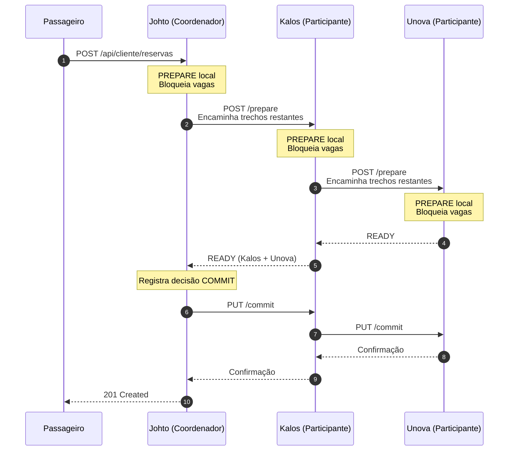
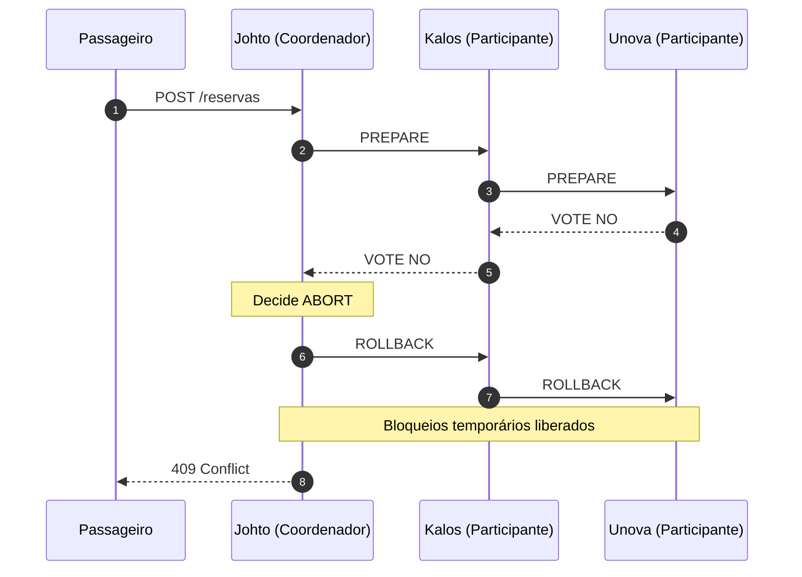
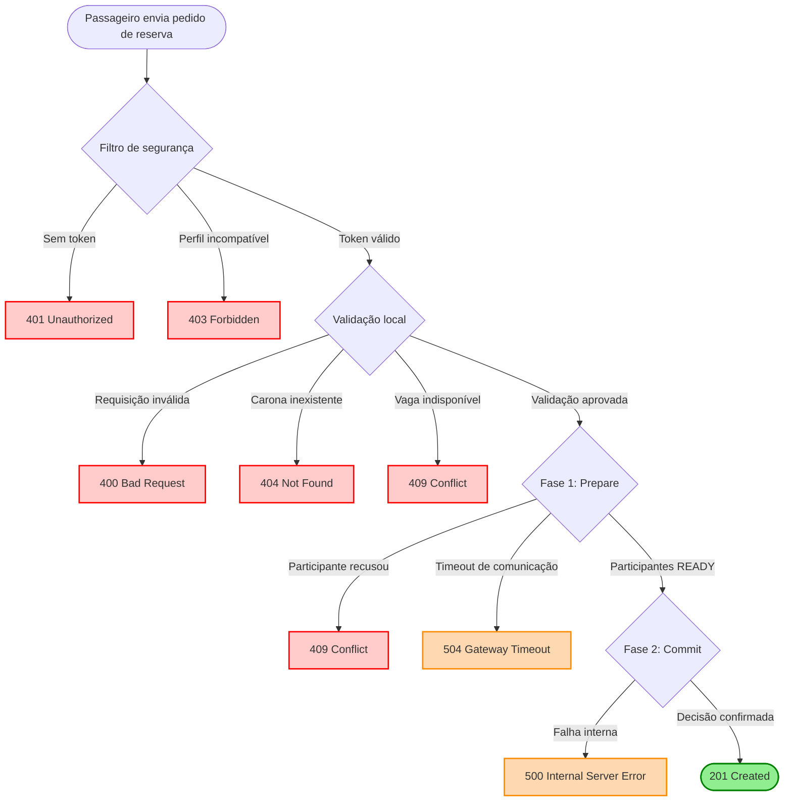
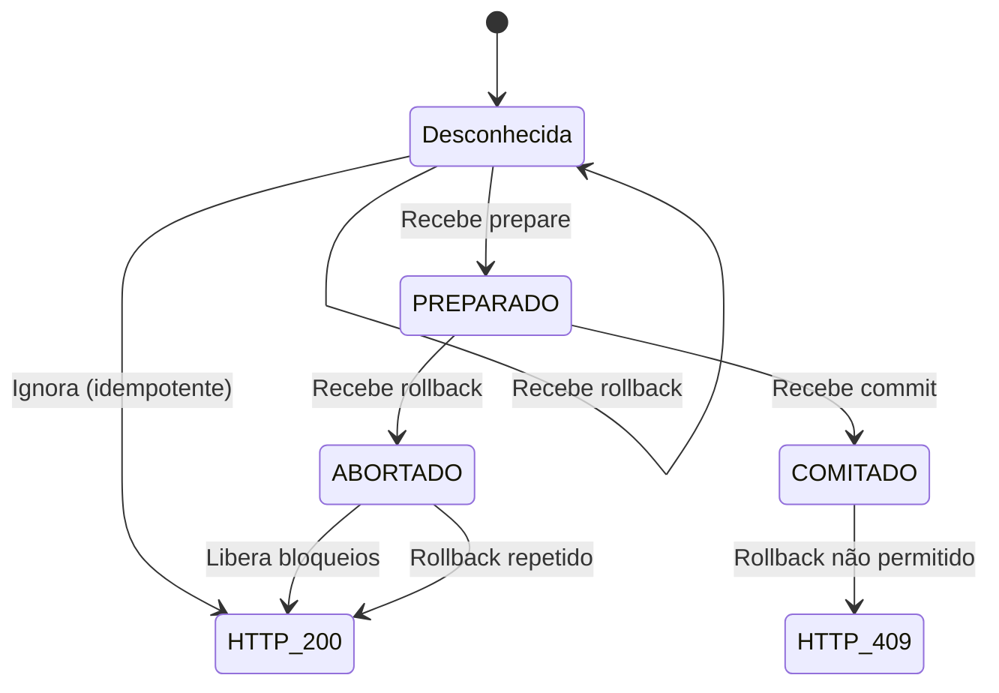

# VaiJunto: Consórcio de Caronas P2P (Versão Java)

Servidor P2P desenvolvido em **Java com Javalin** para o consórcio de caronas compartilhadas (Problema 2).

Cada servidor representa uma rede de trânsito regional (Kanto, Johto, Hoenn etc.), mantém seus próprios dados em disco e comunica-se exclusivamente com servidores vizinhos de fronteira por meio de uma API REST HTTP.

A arquitetura não possui servidor central, coordenador fixo ou banco de dados compartilhado. Cada nó é responsável pelos dados de sua região e participa das operações distribuídas quando necessário.

> **Estado atual:** busca distribuída de itinerários, reserva distribuída utilizando Two-Phase Commit (2PC) encadeado, ordenação de requisições por Relógio Lógico de Lamport, recuperação de estado por meio de Push assíncrono e Lazy Check (Pull sob demanda), cancelamento de viagens e persistência em disco.

## Sumário

1. [Requisitos e Execução](#1-requisitos-e-execução)
2. [Como Rodar o Projeto](#2-como-rodar-o-projeto)
3. [Topologia da Rede](#3-topologia-da-rede)
4. [Estrutura do Projeto](#4-estrutura-do-projeto)
5. [Modelo de Dados](#5-modelo-de-dados)
6. [API do Cliente](#6-api-do-cliente-passageiros-e-motoristas)
7. [API do Consórcio](#7-api-do-consórcio-servidor-para-servidor)
8. [Arquitetura de Tolerância a Falhas](#8-arquitetura-de-tolerância-a-falhas)
9. [Diagramas de Sequência](#9-diagramas-de-sequência)
10. [Decisões Arquiteturais](#10-decisões-arquiteturais-relatório)

---

## 1. Requisitos e Execução

- **Java 24:** versão utilizada no desenvolvimento e na compilação do projeto.
- **Maven:** gerenciamento de dependências e compilação.
- **Docker e Docker Compose:** execução isolada dos servidores e configuração da rede P2P.
- **Dependências principais:**
   - **Javalin:** implementação da API HTTP.
   - **Jackson:** serialização e desserialização JSON.
   - **SLF4J:** abstração para registro de logs.

O projeto utiliza Maven para gerenciar seus módulos e dependências. Cada servidor pode ser executado independentemente, recebendo sua região e porta de inicialização por configuração.

## 2. Como Rodar o Projeto

O projeto pode ser executado de duas formas: utilizando Docker, para isolamento dos processos e facilidade de configuração da rede, ou diretamente na máquina local.

### Opção 1: Com Docker (Recomendado)

A execução com Docker utiliza a rede interna definida em `compose.yaml`, na qual cada região é executada em seu próprio contêiner. As dependências do Maven são gerenciadas em cache, e os comandos de execução estão disponíveis no `Makefile`.

**Para gerenciar toda a rede:**

| Comando        | Descrição                                                                                                          |
|----------------|--------------------------------------------------------------------------------------------------------------------|
| `make build`   | Reconstrói as imagens dos servidores.                                                                              |
| `make up`      | Inicia os quatro servidores do consórcio em segundo plano.                                                         |
| `make down`    | Encerra e remove os contêineres e a rede P2P.                                                                      |
| `make compile` | Compila e empacota o projeto utilizando um contêiner temporário, refletindo os artefatos na pasta `target/` local. |

Os quatro servidores são:

- Unova
- Kalos
- Johto
- Kanto

**Para executar servidores individualmente:**

É possível abrir quatro terminais e iniciar cada servidor separadamente, permitindo acompanhar os logs e simular falhas de maneira independente.

```bash
make unova  # Terminal 1
make kalos  # Terminal 2
make johto  # Terminal 3
make kanto  # Terminal 4
```

Essa abordagem é útil para testar a comunicação entre nós e observar o comportamento da rede quando um servidor é interrompido.

Para simular uma queda, basta encerrar um dos processos com `Ctrl + C` e observar os mecanismos de timeout, notificação e reconciliação de estado.

### Opção 2: Localmente (Sem Docker)

Para executar os processos Java diretamente na máquina, utilize o `Makefile.local`, que invoca o Maven instalado no sistema.

O servidor utiliza as variáveis de ambiente `REGIAO` e `PORT` para determinar sua região e porta de inicialização.

**Atalho para os comandos:**

Para evitar escrever `make -f Makefile.local` repetidamente, pode-se configurar um alias na sessão do terminal:

```bash
alias mk='make -f Makefile.local'
```

**1. Compile o projeto antes de iniciar os servidores:**

```bash
mk compile
```

Esse comando compila o projeto sem executar os servidores, ignorando a etapa de testes.

**2. Inicie os servidores individualmente:**

Após a compilação, abra quatro terminais e execute:

```bash
mk unova  # Inicia Unova na porta 2602
mk kalos  # Inicia Kalos na porta 2603
mk johto  # Inicia Johto na porta 2604
mk kanto  # Inicia Kanto na porta 2605
```

**Importante:** os comandos `mk unova`, `mk kalos`, `mk johto` e `mk kanto` utilizam o modo `run-only`, ou seja, iniciam os servidores sem executar novamente a compilação. Caso o código-fonte seja alterado, execute `mk compile` novamente antes de iniciar os processos.

**Inicialização com parâmetros personalizados:**

Também é possível iniciar uma região diferente das configurações padrão:

```bash
mk run-only REGIAO=Hoenn PORT=3010
```

**Outros comandos disponíveis:**

| Comando | Descrição |
|---|---|
| `mk compile` | Compila o projeto sem executar os servidores, ignorando os testes. |
| `mk clean` | Remove os arquivos compilados e as pastas `target/`. |
| `mk run-only REGIAO=kanto` | Inicia o servidor Kanto sem executar novamente a etapa de compilação. |
---

## 3. Topologia da Rede

Os servidores comunicam-se exclusivamente com seus vizinhos diretos por HTTP. As operações distribuídas são encaminhadas pela rede de acordo com a topologia regional.

Cada servidor mantém os dados de sua própria região, sendo responsável por executar localmente as operações que envolvem suas caronas.

| Servidor / Região           | Porta | Vizinhos diretos                       | Conexões externas (cidades)     |
|-----------------------------|------:|----------------------------------------|---------------------------------|
| **Unova Metro Lines**       |  2602 | Lumiose Express (Kalos), Kanto Transit | Cerulean, Snowbelle, Anistar    |
| **Lumiose Express (Kalos)** |  2603 | Unova Metro, Johto Magnet              | Mistralton, Icirrus, Blackthorn |
| **Johto Magnet Railways**   |  2604 | Lumiose Express, Kanto Transit         | Veniville, Geosenge, Lavender   |
| **Kanto Transit Authority** |  2605 | Unova Metro, Johto Magnet              | Castelia, New Bark Town         |

A topologia é definida por conexões entre regiões. Uma comunicação direta entre dois servidores só é permitida quando existe uma relação de vizinhança configurada.

A busca distribuída utiliza essa topologia para encontrar itinerários entre diferentes regiões. Na reserva, o protocolo encadeado encaminha a transação entre os servidores envolvidos, respeitando a sequência de participantes.

---

## 4. Estrutura do Projeto

```text
org.UEFS/
├── Server/
│   ├── controller/          # Controladores HTTP Javalin
│   │
│   ├── domain/              # Regras de negócio e repositórios
│   │   ├── caronas/         # Carona, ArestaTrecho, IdPerna
│   │   ├── cidades/         # CidadeJSON, CidadeMapper
│   │   └── reservas/        # Transacao, TransacaoService
│   │
│   ├── exceptions/          # Exceções padronizadas do domínio
│   │
│   └── http/                # Infraestrutura de comunicação P2P
│       ├── cluster/         # PeerClient e ResultadoRepasse
│       ├── relogio/         # RelogioLamport
│       └── service/         # Serviços de busca e orquestração do 2PC
│
└── shared/
    ├── dto/                 # Records de transferência de dados
    └── enums/               # Estados de transação e status HTTP
```

A divisão separa as regras de negócio da infraestrutura HTTP e dos mecanismos de comunicação distribuída.

O módulo `shared` concentra estruturas utilizadas na comunicação entre os diferentes componentes, mantendo os formatos de transferência consistentes.

---

## 5. Modelo de Dados

### Carona

Representa uma viagem publicada por um motorista em um servidor regional.

Uma carona possui:

- Identificação do motorista.
- Quantidade de vagas.
- Data e horário de partida.
- Rota composta por cidades consecutivas.
- Preço associado aos segmentos da rota.

Uma mesma carona pode atender passageiros que percorrem diferentes partes de seu trajeto.

### Segmento de rota

Representa a ligação entre duas cidades consecutivas da rota de uma carona.

Por exemplo:

```text
A → B → C → D
```

Essa rota possui três segmentos:

```text
A → B
B → C
C → D
```

Os segmentos descrevem a estrutura da rota, mas não representam necessariamente reservas independentes.

### Perna reservável (`IdPerna`)

Representa o percurso solicitado de uma origem até um destino dentro de uma carona.

Uma perna pode abranger vários segmentos consecutivos da rota, mantendo as cidades intermediárias como informação complementar.

Exemplo:

```text
Rota da carona:
A → B → C → D

Percurso solicitado:
A → D

Paradas intermediárias:
B, C
```

Nesse caso, o passageiro reserva uma única perna de uma única carona. As cidades B e C são paradas intermediárias, não baldeações.

O identificador `IdPerna` permite representar o percurso solicitado dentro da carona original, identificando sua origem e destino.

### Baldeação

Uma baldeação ocorre quando o passageiro precisa trocar de carona para continuar seu itinerário.

Por exemplo:

```text
Carona 1: A → B → C
Carona 2: C → D → E
```

O passageiro realiza uma baldeação em C.

Portanto:

- Parada intermediária: mudança de cidade dentro da mesma carona.
- Baldeação: troca de carona para continuar o percurso.

### Transação (2PC)

Representa uma operação distribuída de reserva, gerenciada pela classe `Transacao`.

Armazena informações necessárias para o protocolo, como:

- Identificador da transação.
- Identificador do coordenador original.
- Relógio lógico associado à operação.
- Estado atual da transação.
- Trechos locais cujas vagas foram bloqueadas.
- Itinerário completo, utilizado como recibo da reserva.

O armazenamento dos trechos locais é separado do itinerário global para evitar que cada servidor tente manipular ou liberar recursos pertencentes a outros nós.

---

## 6. API do Cliente (Passageiros e Motoristas)

Prefixo: `/api/cliente`

As operações protegidas exigem autenticação por token, validado pelo `UserController`.

Erros de autenticação e autorização são padronizados, utilizando os códigos HTTP `401` e `403`.

### `POST /api/cliente/caronas`

Cria uma carona no servidor atual.

**Payload (`NovaCaronaRequest`):**

```json
{
  "idMotorista": "mot_ash",
  "vagas": 4,
  "dataPartida": "2026-10-31T08:00:00",
  "trechos": [
    {
      "origem": 1,
      "destino": 2,
      "preco": 50.0
    },
    {
      "origem": 2,
      "destino": 3,
      "preco": 30.0
    }
  ]
}
```

As cidades de origem e destino devem pertencer à região administrada pelo servidor que recebe a requisição.

A validação dessa restrição deve ocorrer no servidor, independentemente das validações realizadas pela interface do cliente.

### Busca distribuída de itinerários

**Endpoint:** `GET <CAMINHO_REAL_DA_BUSCA>`

Consulta itinerários entre cidades de diferentes regiões, utilizando a comunicação P2P para consultar os servidores envolvidos.

O resultado é composto por uma lista de itinerários, cada um contendo suas pernas reserváveis.

Cada perna informa:

- Servidor responsável pela carona.
- Identificador da carona.
- Origem e destino do percurso solicitado.
- Horário de partida.
- Preço.
- Quantidade de assentos livres.
- Lista de paradas intermediárias.

**Exemplo ilustrativo de uma perna:**

```json
{
  "servidor": "johto",
  "id_carona": "carona_johto_1_4",
  "origem": "Cidade A",
  "destino": "Cidade D",
  "horario": "2026-10-31T08:00:00",
  "preco": 80.0,
  "assentos_livres": 3,
  "paradas_intermediarias": [
    "Cidade B",
    "Cidade C"
  ]
}
```

As paradas intermediárias fazem parte da mesma perna reservável e não são contabilizadas como baldeações.

O preço total do itinerário corresponde à soma dos preços de suas pernas.

Uma baldeação ocorre somente quando o passageiro precisa utilizar outra carona.

### `POST /api/cliente/reservas`

Inicia uma reserva distribuída utilizando o protocolo Two-Phase Commit (2PC).

O servidor que recebe a requisição assume o papel de coordenador, valida as condições locais e encaminha a transação aos demais participantes da cadeia.

**Payload:**

```json
{
  "trechos_solicitados": [
    {
      "servidor": "johto",
      "id_carona": "carona_johto_1_2"
    },
    {
      "servidor": "kalos",
      "id_carona": "carona_kalos_2_3"
    }
  ]
}
```

Cada elemento representa uma perna reservável de uma carona.

As paradas intermediárias não são enviadas como reservas independentes, pois pertencem à mesma carona e já estão representadas na perna solicitada.

### `DELETE /api/cliente/reservas/{id}`

Cancela uma reserva confirmada.

A operação libera as vagas associadas à reserva e inicia a propagação assíncrona da notificação de cancelamento aos servidores envolvidos.

A resposta ao cliente não precisa aguardar a conclusão de todas as notificações remotas.

---

## 7. API do Consórcio (Servidor-para-Servidor)

Prefixo: `/api/consorcio`

Utilizada exclusivamente para comunicação entre servidores, sendo gerenciada pelo `PeerClient` e pelos serviços de orquestração.

As requisições incluem os seguintes headers:

| Header            | Descrição                                                      |
|-------------------|----------------------------------------------------------------|
| `X-Server-Id`     | Identificador regional do servidor remetente.                  |
| `X-Lamport-Clock` | Carimbo de tempo lógico utilizado na ordenação de requisições. |

O relógio de Lamport permite ordenar eventos distribuídos. Quando necessário, o identificador do servidor pode ser utilizado como critério secundário de desempate.

### `POST /api/consorcio/reservas/prepare`

**Fase 1 do 2PC — Preparação.**

O servidor recebe a solicitação de reserva, identifica os trechos que pertencem à sua região, verifica a disponibilidade e bloqueia temporariamente as vagas correspondentes.

Em seguida, encaminha os trechos restantes ao próximo servidor da cadeia.

**Payload (`ReservaRequest`):**

```json
{
  "id_transacao": "b3f1-4c9a...",
  "coordenador_id": "johto",
  "passageiro": "user_ash",
  "relogio_logico": 42,
  "trechos_solicitados": [
    {
      "servidor": "kalos",
      "id_carona": "carona_kalos_2_3"
    },
    {
      "servidor": "unova",
      "id_carona": "carona_unova_3_4"
    }
  ]
}
```

**Resposta de sucesso (`RespostaPrepare`):**

```json
{
  "status": "READY",
  "assentos": [
    {
      "servidor": "kalos",
      "id_carona": "carona_kalos_2_3",
      "assento": 2
    }
  ]
}
```

A resposta agrega as informações dos participantes que conseguiram preparar a reserva.

Se algum participante recusar a operação, a cadeia deve iniciar o procedimento de aborto e liberar os bloqueios realizados.

### `PUT /api/consorcio/reservas/{id}/commit`

**Fase 2 do 2PC — Confirmação.**

Recebe a decisão de commit do coordenador e confirma a reserva localmente.

O servidor registra a decisão, finaliza a ocupação dos assentos e encaminha a confirmação ao próximo participante.

A operação deve ser idempotente: receber novamente a mesma decisão não deve duplicar a reserva nem alterar incorretamente seu estado.

### `DELETE /api/consorcio/reservas/{id}`

Propaga o cancelamento de uma reserva pela rede.

A operação libera os recursos associados à reserva e notifica os demais servidores envolvidos.

O mecanismo de propagação utiliza o identificador da transação para reconhecer notificações repetidas e evitar ciclos de comunicação.

---

## 8. Arquitetura de Tolerância a Falhas

O sistema combina duas estratégias complementares para lidar com falhas de comunicação e divergências temporárias entre os servidores:

1. Push assíncrono de notificações.
2. Pull sob demanda por meio de Lazy Check.

Esses mecanismos reduzem a necessidade de sincronização contínua entre todos os nós.

### 8.1. Push assíncrono

Ao cancelar uma carona ou reserva, o serviço responsável inicia a propagação das notificações aos demais servidores envolvidos.

A comunicação é executada assincronamente, por meio de `CompletableFuture.runAsync()`, evitando que o processamento da requisição do cliente precise aguardar a conclusão de todas as notificações remotas.

São utilizados timeouts reduzidos, na faixa de 2 a 3 segundos, para limitar o tempo de espera por servidores indisponíveis.

Se um servidor estiver acessível, ele poderá processar a notificação e atualizar seu estado local.

Entretanto, a execução assíncrona não garante que todos os participantes recebam a mensagem imediatamente. Uma falha de comunicação pode deixar alguns nós temporariamente com informações desatualizadas.

### 8.2. Pull sob demanda (Lazy Check)

O Lazy Check funciona como mecanismo de reconciliação sob demanda.

Quando um servidor identifica uma situação em que seus dados podem estar desatualizados, consulta a fonte responsável pela informação para verificar o estado atual.

O mecanismo é aplicado em diferentes situações:

**Na perspectiva do motorista:**

O método `sincronizarPorCarona(idCarona)` é acionado antes de apresentar a carona na interface, consultando o coordenador para verificar se as informações locais continuam válidas.

**Na perspectiva do passageiro:**

Ao consultar as reservas por meio de `GET /api/cliente/reservas`, o método `sincronizarStatus(tx)` verifica o estado das transações e permite reconciliar registros desatualizados.

Assim, mesmo que uma notificação Push não alcance determinado servidor, uma consulta posterior poderá identificar e corrigir a divergência.

### 8.3. Limitações do Two-Phase Commit

O 2PC oferece uma decisão atômica para a transação distribuída quando seus participantes respeitam o protocolo e as decisões são persistidas corretamente.

Entretanto, o protocolo possui uma limitação importante: pode bloquear durante determinadas falhas.

Por exemplo:

1. Todos os participantes respondem `READY`.
2. O coordenador registra a decisão `COMMIT`.
3. O coordenador cai antes de comunicar a decisão aos participantes.
4. Os participantes podem permanecer com os recursos bloqueados até recuperarem a decisão.

Portanto, o sistema não garante disponibilidade contínua durante qualquer partição de rede.

Os mecanismos de persistência e recuperação permitem retomar o processamento após falhas, mas não eliminam todas as limitações inerentes ao 2PC.

### 8.4. Tratamento de timeouts

Um timeout indica que a comunicação não foi concluída dentro do intervalo esperado. Ele não comprova que o servidor remoto deixou de executar a operação.

Por exemplo, um participante pode ter recebido o `PREPARE`, bloqueado as vagas e enviado `READY`, mas a resposta pode ter sido perdida durante a comunicação.

Nessa situação, o coordenador pode desconhecer o resultado real da operação remota.

Por isso, em caso de timeout, o servidor tenta propagar o aborto da transação, utilizando o identificador persistente da operação.

A recuperação depende de:

- Identificação persistente das transações.
- Operações idempotentes.
- Registro durável das decisões.
- Verificação do estado da transação antes de aplicar commit ou rollback.
- Recuperação dos registros após a reinicialização dos servidores.

Uma decisão `COMMIT` já persistida não pode ser revertida por uma tentativa posterior de rollback.

---

## 9. Diagramas de Sequência

### 9.1. 2PC Encadeado (Johto → Kalos → Unova)

O diagrama representa uma reserva distribuída envolvendo três regiões.



### 9.2. Fluxo de falha durante a preparação

O exemplo mostra uma recusa de um participante durante a primeira fase.



### 9.3. Árvore de decisão: erros no fluxo de reserva



### 9.4. Catálogo geral de erros

| Código HTTP | Categoria | Nome                  | Significado                                                                                                       |
|-------------|-----------|-----------------------|-------------------------------------------------------------------------------------------------------------------|
| `400`       | Cliente   | Bad Request           | Requisição malformada, JSON inválido, parâmetros incorretos ou violação de regras estruturais do itinerário.      |
| `401`       | Cliente   | Unauthorized          | Ausência de token, token inválido ou expirado.                                                                    |
| `403`       | Cliente   | Forbidden             | Usuário autenticado sem permissão para executar a operação.                                                       |
| `404`       | Cliente   | Not Found             | Recurso solicitado inexistente, como carona ou transação não encontrada em operações que exigem sua existência.   |
| `409`       | Cliente   | Conflict              | Conflito de estado, como falta de vagas, carona duplicada ou tentativa de rollback após uma decisão irreversível. |
| `500`       | Servidor  | Internal Server Error | Falha interna, como erro de leitura ou gravação dos arquivos persistidos.                                         |
| `502`       | Rede      | Bad Gateway           | Resposta inválida ou inesperada recebida de um servidor participante.                                             |
| `503`       | Servidor  | Service Unavailable   | Serviço temporariamente indisponível para executar determinada operação.                                          |
| `504`       | Rede      | Gateway Timeout       | Servidor participante não respondeu dentro do tempo limite da comunicação.                                        |

Os códigos são utilizados conforme a natureza da falha. A aplicação pode padronizar respostas específicas do protocolo, desde que mantenha a distinção entre erros de entrada, conflitos de estado e falhas de comunicação.

### 9.5. Ciclo de vida do rollback

O rollback é utilizado para abortar uma transação que ainda não teve uma decisão de commit registrada.

O comportamento deve considerar o estado persistido da transação.



Uma transação que já teve sua decisão `COMMIT` persistida não pode ser revertida por rollback.

O cancelamento de uma reserva confirmada é uma operação de negócio distinta, com fluxo próprio de liberação de vagas e propagação de notificações.

---

## 10. Decisões Arquiteturais (Relatório)

### 10.1. Roteamento P2P e separação de responsabilidades

**Topologia física e busca distribuída:**

A topologia da rede é utilizada pelo algoritmo de busca para encontrar itinerários entre regiões conectadas.

A busca consulta os servidores necessários para encontrar caminhos válidos, respeitando as conexões de fronteira.

**Reserva distribuída:**

Durante o 2PC, cada servidor processa os trechos que pertencem à sua própria região e encaminha o restante da transação ao próximo participante.

A validação das condições locais é realizada por cada servidor envolvido. A validação da cadeia de participantes é distribuída entre o coordenador e os participantes, conforme suas respectivas responsabilidades.

Essa abordagem evita concentrar todo o processamento em um único servidor.

### 10.2. Isolamento dos recibos

O campo `locais` do objeto `Transacao` armazena somente os trechos cujas vagas foram bloqueadas pelo próprio servidor.

O itinerário global é armazenado separadamente em `itinerarioCompleto`, permitindo que o passageiro tenha acesso ao recibo completo sem que cada servidor precise manipular recursos pertencentes aos demais participantes.

Essa separação também evita tentativas de liberação de vagas inexistentes no repositório local.

### 10.3. Abandono de listeners implícitos

A orquestração do cancelamento foi implementada por meio de um fluxo explícito, gerenciado pelo `CaronaController` e pelos serviços responsáveis.

Essa decisão foi tomada para tornar mais previsível a sequência de operações, especialmente quando diferentes componentes poderiam tentar liberar a mesma vaga em resposta a um único evento.

A abordagem procedural facilita a identificação dos pontos de entrada, a propagação das notificações e o tratamento de falhas.

### 10.4. Timeouts reduzidos (Fail-Fast)

Timeouts longos no módulo HTTP podem manter threads ocupadas aguardando servidores indisponíveis, aumentando o risco de esgotamento de recursos.

Por esse motivo, os timeouts de comunicação do `PeerClient` foram reduzidos para aproximadamente 2 a 3 segundos.

Essa estratégia permite detectar rapidamente falhas de comunicação e iniciar os procedimentos de recuperação.

Entretanto, um timeout não comprova que a operação remota deixou de ser executada. Por isso, o sistema utiliza identificadores persistentes e operações idempotentes para tratar respostas perdidas e requisições repetidas.

### 10.5. Relógio Lógico de Lamport

O sistema utiliza relógios lógicos de Lamport para atribuir timestamps aos eventos distribuídos.

Cada mensagem de comunicação entre servidores carrega seu respectivo timestamp no header `X-Lamport-Clock`.

Essa informação permite estabelecer uma ordenação lógica dos eventos, inclusive quando ocorrem em servidores diferentes.

Quando dois eventos possuem o mesmo timestamp, o identificador do servidor pode ser utilizado como critério secundário de ordenação.

O relógio lógico não representa o horário físico exato de execução, mas preserva a relação de causalidade necessária para a ordenação dos eventos distribuídos.

---

## Considerações finais

O VaiJunto utiliza uma arquitetura P2P na qual cada servidor administra sua própria região e coopera com os demais para oferecer funcionalidades distribuídas.

A busca distribuída permite encontrar itinerários que atravessam diferentes regiões, enquanto o protocolo 2PC coordena a reserva de vagas entre os servidores envolvidos.

A combinação de persistência local, comunicação assíncrona, relógios lógicos e reconciliação sob demanda busca oferecer consistência entre os nós mesmo diante de falhas temporárias de comunicação.

A arquitetura não depende de um servidor central, mantendo a responsabilidade pelos dados e pelas operações distribuída entre os participantes do consórcio.