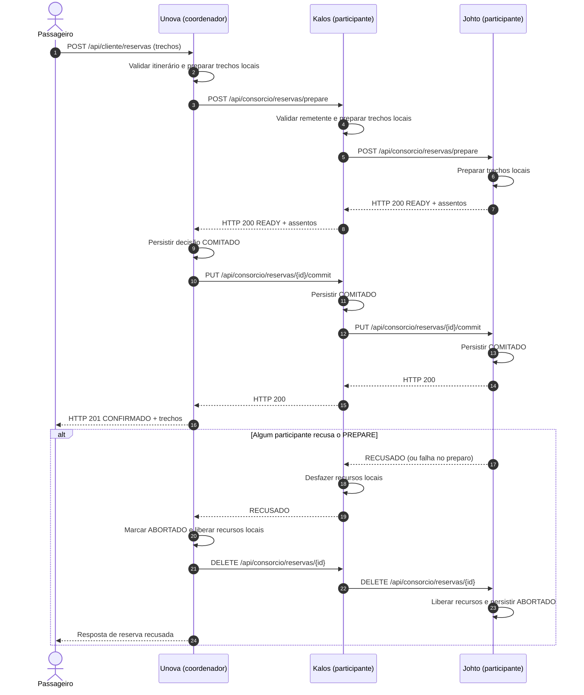

# VaiJunto — Sistema Distribuído de Caronas P2P


O **VaiJunto** é um sistema distribuído para publicação, busca e reserva de caronas. A aplicação utiliza Java e uma arquitetura *peer-to-peer* (P2P): cada servidor administra os dados de sua região e coopera com os servidores vizinhos quando uma operação atravessa fronteiras regionais.

A aplicação possui uma interface Web servida pelo próprio backend. Os servidores comunicam-se por HTTP, realizam buscas distribuídas e coordenam reservas que envolvem mais de uma região utilizando **Two-Phase Commit (2PC)**. Relógios lógicos de Lamport, persistência local e mecanismos de recuperação complementam esse fluxo.

Este documento descreve o estado da branch `parte_2` consultado no repositório. As inconsistências de configuração identificadas durante a revisão estão destacadas na seção [Estado atual e pendências de configuração](#14-estado-atual-e-pendências-de-configuração).

---

## Sumário

1. [Funcionalidades](#1-funcionalidades)
2. [Arquitetura e configuração regional](#2-arquitetura-e-configuração-regional)
3. [Tecnologias e requisitos](#3-tecnologias-e-requisitos)
4. [Estrutura do projeto](#4-estrutura-do-projeto)
5. [Compilação](#5-compilação)
6. [Execução](#6-execução)
7. [Interface Web](#7-interface-web)
8. [API do cliente](#8-api-do-cliente)
9. [API entre servidores](#9-api-entre-servidores)
10. [Busca distribuída](#10-busca-distribuída)
11. [Reservas distribuídas e concorrência](#11-reservas-distribuídas-e-concorrência)
12. [Persistência e recuperação](#12-persistência-e-recuperação)
13. [Relógios lógicos de Lamport](#13-relógios-lógicos-de-lamport)
14. [Estado atual e pendências de configuração](#14-estado-atual-e-pendências-de-configuração)
15. [Testes](#15-testes)
16. [Limitações](#16-limitações)

---

## 1. Funcionalidades

O sistema oferece dois perfis principais:

### Motorista

- Criar uma conta e autenticar-se.
- Cadastrar os dados de motorista e veículo.
- Publicar uma carona com uma rota composta por trechos consecutivos.
- Consultar as próprias caronas e a ocupação de cada trecho.
- Cancelar uma carona, propagando o cancelamento às reservas associadas.

### Passageiro

- Criar uma conta e autenticar-se.
- Buscar itinerários por origem, destino, data e quantidade de vagas.
- Consultar os trechos, horários, preços e assentos disponíveis de cada itinerário.
- Reservar itinerários locais ou distribuídos entre servidores.
- Consultar e cancelar as próprias reservas.

### Viagens por trechos

Uma carona pode conter vários trechos consecutivos. A disponibilidade é controlada por trecho, e não apenas pela viagem inteira. Assim, passageiros diferentes podem ocupar partes distintas da mesma rota, desde que não disputem os mesmos assentos nos trechos em comum.

```text
Cidade A -------- Cidade B -------- Cidade C -------- Cidade D
       Trecho 1          Trecho 2          Trecho 3
```

Um itinerário também pode combinar caronas de servidores diferentes:

```text
Unova: Cidade A -> Cidade B
             |
Kalos:       Cidade B -> Cidade C
                         |
Johto:                   Cidade C -> Cidade D
```

Cada servidor reserva e administra somente os recursos que pertencem à sua região.

---

## 2. Arquitetura e configuração regional

A aplicação é formada por processos independentes. Não existe um servidor central que armazene todos os usuários e todas as caronas. Cada nó mantém seus próprios dados e consulta os vizinhos configurados quando precisa buscar informações ou reservar recursos remotos.

### 2.1. Regiões configuradas atualmente

O arquivo `Server/src/main/resources/regioes.json` contém, no estado consultado, três regiões:

| Região | Identificador do servidor | Porta | Vizinhos configurados |
|---|---|---:|---|
| Unova | `localhost:2602` | 2602 | Kalos |
| Kalos | `localhost:2603` | 2603 | Unova e Johto |
| Johto | `localhost:2604` | 2604 | Kalos |

A topologia configurada é uma cadeia:

```text
Unova -------- Kalos -------- Johto
```

O identificador utilizado nas mensagens entre servidores é formado pelo endereço IP e pela porta (`ip:porta`). Portanto, em uma execução local, os identificadores são `localhost:2602`, `localhost:2603` e `localhost:2604`; eles não são simplesmente os nomes das regiões.

### 2.2. Arquivo de regiões

`regioes.json` define, para cada nó:

- Endereço IP e porta.
- Nome do servidor e região-base.
- Cidades pertencentes à região (`cidades_base`).
- Cidades de fronteira utilizadas como conexões externas (`conexoes_externas`).
- Servidores vizinhos (`servidores_vizinhos`).

A classe `ServerConstant` carrega esse arquivo e determina a região atual, o identificador do servidor e os vizinhos. As variáveis de ambiente `HOST_UNOVA`, `HOST_KALOS`, `HOST_JOHTO` e `HOST_KANTO` podem substituir os endereços IP utilizados na comunicação entre processos — por exemplo, pelos nomes dos serviços Docker.

### 2.3. Cidades

O arquivo `Server/src/main/resources/public/data/cidades.json` contém os dados geográficos utilizados pela interface e pela busca: identificadores, nomes, coordenadas, região e conexões entre cidades.

A classe `CidadeMapper` converte nomes em identificadores e identificadores em nomes, além de identificar cidades locais e conexões externas. O endpoint `/api/servidor/cidades` disponibiliza as cidades associadas à configuração regional do servidor atual.

---

## 3. Tecnologias e requisitos

| Tecnologia | Utilização |
|---|---|
| Java 24 | Linguagem principal |
| Maven | Compilação e gerenciamento de dependências |
| Javalin 7.2.4 | Servidor HTTP e API REST |
| Jackson 2.22.3 | Serialização JSON |
| Jackson JSR310 | Conversão de tipos de data e hora |
| SLF4J e Logback | Registro de logs |
| JUnit 5 e Mockito | Dependências disponíveis para testes automatizados |
| HTML, CSS e JavaScript | Interface Web |
| Docker e Docker Compose | Empacotamento e execução dos servidores |
| Bash, cURL e jq | Scripts de integração e concorrência |

### Requisitos

Para compilação e execução local:

- JDK 24.
- Maven 3.9 ou compatível.
- Git.
- GNU Make, caso queira utilizar `Makefile.local`.

Para execução em contêineres:

- Docker Engine ou Docker Desktop com Docker Compose.

Para os scripts em `Test/`:

- Bash.
- cURL.
- jq.
- Em alguns scripts, ferramentas GNU como `date -d`.

No Windows, recomenda-se utilizar WSL 2 com Ubuntu para executar os Makefiles e os scripts Bash.

---

## 4. Estrutura do projeto

O projeto utiliza Maven Multi-Module e possui dois módulos: `Shared` e `Server`.

```text
MI_Redes_VaiJunto/
├── Shared/
│   └── src/main/java/org/UEFS/shared/
│       ├── dto/
│       │   ├── consorcio/
│       │   ├── requests/
│       │   └── responses/
│       ├── enums/
│       ├── model/
│       ├── FileManager.java
│       └── JsonUtils.java
│
├── Server/
│   └── src/
│       ├── main/java/org/UEFS/Server/
│       │   ├── controller/
│       │   ├── domain/
│       │   │   ├── caronas/
│       │   │   ├── cidades/
│       │   │   ├── reservas/
│       │   │   └── usuarios/
│       │   ├── exceptions/
│       │   ├── http/
│       │   │   ├── cluster/
│       │   │   ├── relogio/
│       │   │   └── service/
│       │   ├── util/
│       │   └── Main.java
│       └── main/resources/
│           ├── public/
│           │   ├── css/
│           │   ├── data/
│           │   ├── images/
│           │   ├── pages/
│           │   ├── script/
│           │   └── index.html
│           ├── regioes.json
│           └── logback.xml
│
├── Test/
│   ├── concorrencia/
│   ├── comum.sh
│   ├── executar.sh
│   ├── config.json
│   ├── teste-health.sh
│   └── teste-cadastro-carona.sh
│
├── Dockerfile
├── Makefile
├── Makefile.local
├── compose_1.yaml
└── pom.xml
```

### 4.1. Módulo `Shared`

Reúne as estruturas compartilhadas entre os módulos, principalmente DTOs de requisição e resposta, modelos, enums e utilitários para leitura, escrita e conversão de JSON.

Alguns DTOs relevantes:

- `NovaCaronaRequest`: dados para publicar uma carona.
- `ReservaClienteRequest`: solicitação de reserva recebida pela API do cliente.
- `TrechoSolicitado`: servidor, identificador da perna e cidades de origem e destino.
- `ReservaRequest`: mensagem utilizada durante a preparação distribuída.
- `TrechoConsorcioDTO`: trecho retornado pela busca distribuída.

### 4.2. Módulo `Server`

Contém a aplicação servidor, as regras de negócio, os controladores HTTP, a comunicação P2P e os recursos da interface Web.

| Pacote | Responsabilidade |
|---|---|
| `controller/` | Controladores de usuários, sessões e caronas |
| `domain/caronas/` | Caronas, rotas, trechos e ocupação |
| `domain/cidades/` | Mapeamento de cidades e conexões |
| `domain/reservas/` | Transações, reservas e persistência do estado local |
| `domain/usuarios/` | Usuários e repositório de usuários |
| `http/cluster/` | Cliente HTTP para comunicação com vizinhos |
| `http/relogio/` | Configuração regional e relógio de Lamport |
| `http/service/` | Busca distribuída, coordenação, participação e recuperação de transações |
| `resources/public/` | HTML, CSS, JavaScript, mapas e imagens |

### 4.3. Inicialização

A classe `Main`:

1. Carrega as regiões e identifica a região atual.
2. Inicializa o relógio de Lamport e o cliente HTTP P2P.
3. Carrega o mapeamento de cidades e os repositórios locais.
4. Inicializa os serviços de caronas e transações.
5. Reaplica a ocupação correspondente às transações persistidas.
6. Inicializa a busca distribuída, o participante e o coordenador do 2PC.
7. Registra o salvamento dos dados no encerramento.
8. Inicia o servidor HTTP e o recuperador periódico de transações.

A região é informada pela propriedade `server.regiao` ou pelo primeiro argumento da aplicação. A porta efetiva é obtida do registro da região em `regioes.json`.

---

## 5. Compilação

Na raiz do repositório, compile o servidor e suas dependências:

```bash
mvn -pl Server -am install -DskipTests
```

- `-pl Server` seleciona o módulo `Server`.
- `-am` também compila os módulos dos quais ele depende, incluindo `Shared`.
- `-DskipTests` pula a execução dos testes.

Com `Makefile.local`, o comando equivalente é:

```bash
make -f Makefile.local compile
```

Para limpar os diretórios `target/`:

```bash
make -f Makefile.local clean
```

Para limpar e compilar novamente:

```bash
make -f Makefile.local rebuild
```

---

## 6. Execução

### 6.1. Execução local, sem Docker

Primeiro compile o projeto:

```bash
make -f Makefile.local compile
```

Depois, abra um terminal para cada servidor atualmente configurado:

```bash
make -f Makefile.local run-only REGIAO=Unova
```

```bash
make -f Makefile.local run-only REGIAO=Kalos
```

```bash
make -f Makefile.local run-only REGIAO=Johto
```

Também existem atalhos:

```bash
make -f Makefile.local unova
make -f Makefile.local kalos
make -f Makefile.local johto
```

O alvo `run-only` inicia sem recompilar. Quando o código for alterado, execute `compile` novamente antes de iniciar os processos.

Para iniciar uma região manualmente com compilação prévia:

```bash
make -f Makefile.local run REGIAO=Unova
```

**Atenção:** embora o Makefile tenha uma variável `PORT`, a classe `Main` não lê a propriedade `server.port`. A porta utilizada pelo servidor vem de `regioes.json`; portanto, alterar apenas `PORT=` no Makefile não muda a porta efetiva.

### 6.2. Execução com Docker Compose

O arquivo Compose presente no repositório é `compose_1.yaml`. Para iniciar os três serviços que possuem configuração regional, utilize:

```bash
docker compose -f compose_1.yaml up --build unova kalos johto
```

Para acompanhar os logs:

```bash
docker compose -f compose_1.yaml logs -f
```

Para encerrar:

```bash
docker compose -f compose_1.yaml down
```

As portas publicadas são 2602 (Unova), 2603 (Kalos) e 2604 (Johto). O Compose também declara um serviço Kanto na porta 2605, mas a região Kanto ainda não está cadastrada em `regioes.json`; por isso, esse serviço não consegue ser inicializado pela configuração atual.

O volume `./data:/app/data` mantém os dados fora do ciclo de vida dos contêineres. Cada servidor separa seus arquivos de acordo com a própria porta.

**Atenção ao Makefile principal:** `Makefile` ainda define `docker compose -f compose.yaml`, mas esse arquivo não está presente no repositório consultado. Até alinhar esse nome, utilize os comandos Docker Compose explícitos acima em vez dos alvos `make up`, `make build`, `make down` e `make logs`.

---

## 7. Interface Web

O Javalin serve a interface e a API no mesmo processo. A rota `/` redireciona para `/pages/principal.html`.

Os recursos ficam em `Server/src/main/resources/public/`:

- `pages/inicio.html`: telas de autenticação e entrada.
- `pages/principal.html`: área principal do usuário.
- `pages/mapa.html`: busca e publicação de caronas pelo mapa.
- `script/`: lógica das páginas, comunicação HTTP, sessão e configuração regional.
- `css/`: estilos da aplicação.
- `data/cidades.json`: dados geográficos usados pelo mapa.
- `images/`: mapa, imagens e logos regionais.

O script `comum.js` centraliza funções compartilhadas, chamadas à API, avisos, dados de sessão e carregamento das cidades. A lista de cidades é armazenada em cache na sessão do navegador.

A página do mapa permite selecionar cidades e visualizar conexões. No modo de publicação, o motorista define uma sequência de cidades conectadas para formar a rota da carona. O formulário valida os dados da viagem antes do envio. No modo de busca, o passageiro informa origem, destino, data e quantidade de vagas para consultar itinerários.

O endpoint `/api/servidor/cidades` informa a região do processo pelo cabeçalho `X-Server-Region`. O script `servidor.js` utiliza essa informação para selecionar o logo regional exibido pela interface.

---

## 8. API do cliente

As rotas de cliente utilizam o prefixo `/api/cliente`. As operações protegidas recebem o token no cabeçalho:

```http
Authorization: Bearer <TOKEN>
```

### 8.1. Autenticação e perfil

| Método | Rota | Finalidade |
|---|---|---|
| `POST` | `/api/cliente/cadastro` | Criar uma conta |
| `POST` | `/api/cliente/login` | Autenticar um usuário |
| `POST` | `/api/cliente/logout` | Encerrar a sessão |
| `GET` | `/api/cliente/eu` | Consultar o usuário associado à sessão |
| `POST` | `/api/cliente/cadastro/motorista` | Cadastrar o perfil de motorista |

Exemplo de cadastro:

```json
{
  "email": "usuario@exemplo.com",
  "senha": "senha123",
  "nome": "Nome do Usuário"
}
```

Exemplo de cadastro do perfil de motorista:

```json
{
  "cnh": "12345678900",
  "placaCarro": "ABC1D23",
  "modeloCarro": "Modelo do veículo",
  "corCarro": "Preto"
}
```

### 8.2. Busca de itinerários

```http
GET /api/cliente/itinerarios?origem=Castelia&destino=Lumiose%20City&data=2026-11-05&vagas=2
Authorization: Bearer <TOKEN>
```

Os quatro parâmetros são obrigatórios:

| Parâmetro | Significado | Formato |
|---|---|---|
| `origem` | Cidade inicial | Nome da cidade |
| `destino` | Cidade final | Nome da cidade |
| `data` | Data desejada para a viagem | `AAAA-MM-DD` |
| `vagas` | Quantidade mínima de assentos livres | Inteiro maior que zero |

A busca combina resultados locais e remotos, respeitando os servidores vizinhos configurados. Os resultados incluem informações como servidor responsável, identificador da perna, origem, destino, horário, preço, assentos livres e paradas intermediárias.

### 8.3. Caronas

| Método | Rota | Finalidade |
|---|---|---|
| `GET` | `/api/cliente/caronas` | Consultar caronas do motorista autenticado |
| `POST` | `/api/cliente/caronas` | Publicar uma carona |
| `DELETE` | `/api/cliente/caronas/{id}` | Cancelar uma carona |
| `POST` | `/api/cliente/rotas` | Rota alternativa para publicação de carona |

Exemplo de publicação:

```json
{
  "idMotorista": "id-do-motorista",
  "vagas": 3,
  "valorPorTrecho": 15.5,
  "dataPartida": "2026-11-05T08:00:00",
  "trechos": [
    "101-102",
    "102-103"
  ]
}
```

`dataPartida` utiliza o formato `yyyy-MM-dd'T'HH:mm:ss`. Cada elemento de `trechos` é uma string `origem-destino`, desserializada pelo tipo `Trecho`.

O servidor valida, entre outros pontos, a identidade do motorista, a origem na região administrada, a continuidade da rota, a existência das conexões, a data futura, a quantidade positiva de vagas e um valor finito não negativo.

### 8.4. Reservas

| Método | Rota | Finalidade |
|---|---|---|
| `GET` | `/api/cliente/reservas` | Consultar reservas do passageiro autenticado |
| `POST` | `/api/cliente/reservas` | Solicitar uma reserva distribuída |
| `DELETE` | `/api/cliente/reservas/{id}` | Cancelar uma reserva |

O corpo do `POST` utiliza a propriedade `trechos`. Cada item identifica o servidor, a perna da carona e as cidades que delimitam o trecho:

```json
{
  "trechos": [
    {
      "servidor": "localhost:2602",
      "id_carona": "carona_550e8400-e29b-41d4-a716-446655440000_101_102",
      "origem": 101,
      "destino": 102
    },
    {
      "servidor": "localhost:2603",
      "id_carona": "carona_650e8400-e29b-41d4-a716-446655440001_108_211",
      "origem": 108,
      "destino": 211
    }
  ]
}
```

Os valores são ilustrativos. `servidor` utiliza o identificador `ip:porta` definido na configuração regional. `id_carona` identifica a perna reservável; `origem` e `destino` são os identificadores numéricos das cidades.

O passageiro não envia seu próprio identificador: ele é obtido a partir do token. O servidor que recebe a solicitação atua como coordenador do 2PC. Quando a reserva é confirmada, a resposta inclui o identificador da transação e o estado `CONFIRMADO`.

### 8.5. Cidades do servidor

```http
GET /api/servidor/cidades
```

Retorna um objeto JSON em que as chaves são identificadores numéricos de cidades e os valores são seus nomes. A resposta também contém o cabeçalho `X-Server-Region` com a região-base do servidor.

---

## 9. API entre servidores

A API interna utiliza HTTP e JSON sob o prefixo `/api/consorcio`. Cada processo administra seus próprios dados; as rotas abaixo permitem consultar informações de outros nós e coordenar operações distribuídas.

### 9.1. Convenções de comunicação

Todas as chamadas feitas pelo `PeerClient` enviam:

| Cabeçalho | Obrigatório no cliente HTTP | Significado |
|---|---|---|
| `X-Server-Id` | Sim | Identificador do servidor remetente, no formato `ip:porta` |
| `X-Lamport-Clock` | Sim | Valor atual do relógio lógico do remetente |
| `Accept` | Sim | `application/json` |
| `Content-Type` | Quando há corpo | `application/json` |

O middleware do servidor processa `X-Lamport-Clock` antes da rota: atualiza o relógio quando o valor é válido ou incrementa o relógio local quando o cabeçalho está ausente/inválido. Depois da rota, todas as respostas sob `/api` recebem:

- `X-Server-Id`: identificador do nó que respondeu.
- `X-Lamport-Clock`: relógio lógico atualizado do nó que respondeu.

O `PeerClient` atualiza seu relógio a partir desse último cabeçalho. Os endpoints internos não usam token de usuário; a autorização da cadeia é feita principalmente pela validação de `X-Server-Id` contra a lista de vizinhos configurados em operações de preparação e cancelamento. Esses cabeçalhos identificam o remetente, mas não constituem autenticação criptográfica.

### 9.2. Recursos e métodos

| Método | Caminho | Parâmetros/corpo | Finalidade |
|---|---|---|---|
| `GET` | `/api/consorcio/health` | — | Verificar disponibilidade e consultar relógio |
| `GET` | `/api/consorcio/vivo` | — | Alias de `health` |
| `GET` | `/api/consorcio/trechos` | Query: `origem`, `destino`, `data`, `vagas`; opcional `visitados` | Buscar itinerários no nó remoto |
| `GET` | `/api/consorcio/usuarios/{id}` | Query opcional: `visitados` | Consultar usuário na rede |
| `POST` | `/api/consorcio/reservas/prepare` | JSON `ReservaRequest` | Preparar os recursos locais e encaminhar o restante da transação |
| `DELETE` | `/api/consorcio/reservas/{id}` | — | Desfazer preparação (rollback) |
| `PUT` | `/api/consorcio/reservas/{id}/commit` | — | Registrar e propagar a decisão de confirmação |
| `PUT` | `/api/consorcio/reservas/{id}/cancel` | — | Receber notificação de cancelamento do passageiro |
| `PUT` | `/api/consorcio/reservas/{id}/cancel-motorista` | — | Receber notificação de cancelamento do motorista |
| `GET` | `/api/consorcio/reservas/{id}/status` | — | Consultar o estado persistido de uma transação |

### 9.3. Verificação de disponibilidade

**Requisição**

```http
GET /api/consorcio/health HTTP/1.1
Host: localhost:2603
X-Server-Id: localhost:2602
X-Lamport-Clock: 42
Accept: application/json
```

**Resposta — HTTP 200**

```json
{
  "status": "localhost:2603 ta on",
  "relogio": 43
}
```

O valor do relógio é ilustrativo; ele depende do estado lógico do servidor no momento da chamada.

### 9.4. Busca remota de trechos

**Requisição**

```http
GET /api/consorcio/trechos?origem=Castelia&destino=Lumiose%20City&data=2026-11-05&vagas=2&visitados=localhost%3A2602 HTTP/1.1
X-Server-Id: localhost:2602
X-Lamport-Clock: 42
Accept: application/json
```

| Parâmetro | Obrigatório | Descrição |
|---|---|---|
| `origem` | Sim | Nome da cidade de origem |
| `destino` | Sim | Nome da cidade de destino |
| `data` | Sim | Data no formato ISO `AAAA-MM-DD` |
| `vagas` | Sim | Inteiro maior que zero |
| `visitados` | Não | Histórico CSV de servidores/cidades visitados para evitar ciclos |

**Resposta — HTTP 200**

O corpo segue os DTOs `BuscaTrechosResponse` e `ItinerarioConsorcioDTO`:

```json
{
  "servidor": "localhost:2603",
  "total": 1,
  "itinerarios": [
    {
      "itinerario_id": "itinerario-exemplo",
      "preco_total": 25.5,
      "trechos": [
        {
          "servidor": "localhost:2603",
          "id_carona": "carona-exemplo",
          "origem": "Castelia",
          "destino": "Lumiose City",
          "horario": "2026-11-05T08:00:00",
          "preco": 25.5,
          "assentos_livres": 3,
          "paradas_intermediarias": []
        }
      ]
    }
  ]
}
```

Os valores acima são ilustrativos. `total` informa a quantidade de itinerários retornados pelo nó; cada trecho identifica o servidor proprietário, a carona, as cidades, o horário, o preço, a disponibilidade e as paradas intermediárias.

**Erros de entrada — HTTP 400**

O endpoint retorna `{"erro":"..."}` quando falta algum dos quatro parâmetros obrigatórios, quando a data não pode ser interpretada como `AAAA-MM-DD` ou quando `vagas` não é um inteiro positivo.

### 9.5. Consulta de usuário remoto

**Requisição**

```http
GET /api/consorcio/usuarios/ID_DO_USUARIO?visitados=localhost%3A2602 HTTP/1.1
X-Server-Id: localhost:2602
X-Lamport-Clock: 42
Accept: application/json
```

O parâmetro opcional `visitados` contém os identificadores dos servidores já consultados, separados por vírgula. O servidor procura o usuário localmente e, se necessário, consulta os vizinhos ainda não visitados.

**Resposta — HTTP 200**

```json
{
  "id": "ID_DO_USUARIO",
  "email": "usuario@exemplo.com",
  "nome": "Nome do Usuário"
}
```

**Não encontrado — HTTP 404** quando nenhum nó consultado encontra o usuário. A consulta remota usa o DTO `OtherUserDTO`.

### 9.6. Preparação de reserva — PREPARE

O coordenador encaminha a cada participante somente os trechos que pertencem àquele servidor e aos servidores seguintes da cadeia.

**Requisição — HTTP POST**

```http
POST /api/consorcio/reservas/prepare HTTP/1.1
X-Server-Id: localhost:2602
X-Lamport-Clock: 43
Content-Type: application/json
Accept: application/json
```

Corpo (`ReservaRequest`):

```json
{
  "id_transacao": "550e8400-e29b-41d4-a716-446655440000",
  "coordenador_id": "localhost:2602",
  "passageiro": "id-do-passageiro",
  "relogio_logico": 43,
  "trechos_solicitados": [
    {
      "servidor": "localhost:2603",
      "id_carona": "carona-550e8400-origem-destino",
      "origem": 108,
      "destino": 211
    }
  ]
}
```

| Campo | Tipo | Descrição |
|---|---|---|
| `id_transacao` | string | Identificador único da transação |
| `coordenador_id` | string | Identificador do servidor coordenador |
| `passageiro` | string | Identificador do passageiro |
| `relogio_logico` | inteiro | Timestamp lógico transportado na solicitação |
| `trechos_solicitados` | array | Trechos a preparar nesta etapa e nas etapas seguintes |
| `trechos_solicitados[].servidor` | string | Identificador do servidor proprietário |
| `trechos_solicitados[].id_carona` | string | Identificador da perna/carona |
| `trechos_solicitados[].origem` | inteiro | ID da cidade de origem |
| `trechos_solicitados[].destino` | inteiro | ID da cidade de destino |

O participante verifica o remetente pelo cabeçalho `X-Server-Id`, valida a cadeia, prepara os trechos que administra e encaminha o restante ao próximo vizinho.

**Preparação aceita — HTTP 200**

```json
{
  "id_transacao": "550e8400-e29b-41d4-a716-446655440000",
  "status": "READY",
  "servidor": "localhost:2603",
  "assentos": [
    {
      "servidor": "localhost:2603",
      "id_carona": "carona-550e8400-origem-destino",
      "origem": 108,
      "destino": 211,
      "assento": 0
    }
  ]
}
```

**Preparação recusada**

Quando o coordenador detecta uma recusa, a resposta padronizada é:

```json
{
  "id_transacao": "550e8400-e29b-41d4-a716-446655440000",
  "servidor": "localhost:2603",
  "status": "RECUSADO",
  "motivo": "Motivo da recusa"
}
```

O código HTTP acompanha a causa: por exemplo, `400` para pedido inválido, `403` para remetente que não é vizinho autorizado, `404` para recurso inexistente e `409` para indisponibilidade/conflito de recurso. Falhas internas podem resultar em `500`; falhas de rede podem ser percebidas pelo chamador como timeout/ausência de resposta, e não como um código HTTP recebido.

### 9.7. Commit

Após receber `READY` de todos os participantes, o coordenador persiste a decisão `COMITADO` e envia:

```http
PUT /api/consorcio/reservas/550e8400-e29b-41d4-a716-446655440000/commit HTTP/1.1
X-Server-Id: localhost:2602
X-Lamport-Clock: 48
```

Não há corpo JSON.

**Resposta — HTTP 200**

```json
{
  "id_transacao": "550e8400-e29b-41d4-a716-446655440000",
  "mensagem": "Transacao comitada com sucesso",
  "propagacao_pendente": false
}
```

`propagacao_pendente` indica se o servidor não conseguiu confirmar o repasse do commit ao próximo participante. A decisão local já foi persistida; o recuperador tenta retomar propagações pendentes.

Erros relevantes: `400` para ID inválido, `404` se a transação não foi preparada naquele servidor e `500` se não foi possível registrar a decisão local.

### 9.8. Rollback

Quando algum participante recusa o PREPARE, o coordenador envia:

```http
DELETE /api/consorcio/reservas/550e8400-e29b-41d4-a716-446655440000 HTTP/1.1
X-Server-Id: localhost:2602
X-Lamport-Clock: 47
```

Não há corpo JSON.

**Resposta — HTTP 200**

```json
{
  "id_transacao": "550e8400-e29b-41d4-a716-446655440000",
  "mensagem": "Transacao abortada com sucesso"
}
```

O participante registra `ABORTADO`, libera a ocupação local e propaga o rollback ao próximo servidor, se houver. Um rollback após a transação já ter sido confirmada é recusado com HTTP `409`; ID inválido gera `400` e falha de persistência pode gerar `500`.

### 9.9. Cancelamentos

As duas operações não possuem corpo JSON. O tipo de cancelamento é indicado pela própria rota.

**Cancelamento solicitado pelo passageiro**

```http
PUT /api/consorcio/reservas/{id}/cancel HTTP/1.1
X-Server-Id: localhost:2602
X-Lamport-Clock: 52
```

Resposta — HTTP 200:

```json
{
  "id_transacao": "550e8400-e29b-41d4-a716-446655440000",
  "mensagem": "Cancelamento recebido"
}
```

O receptor valida se o remetente é um vizinho e registra o estado de cancelamento recebido. ID inválido resulta em `400`; falha ao persistir o cancelamento resulta em `503`.

**Cancelamento iniciado pelo motorista**

```http
PUT /api/consorcio/reservas/{id}/cancel-motorista HTTP/1.1
X-Server-Id: localhost:2602
X-Lamport-Clock: 53
```

Resposta — HTTP 200:

```json
{
  "id_transacao": "550e8400-e29b-41d4-a716-446655440000",
  "status": "CANCELADA_MOTORISTA",
  "mensagem": "Cancelamento registrado"
}
```

Se a transação não existir no nó, a implementação também responde HTTP 200 com `{"id_transacao":"...","mensagem":"Transação inexistente"}`. Falha ao registrar o cancelamento resulta em `503`; ID inválido resulta em `400`.

### 9.10. Consulta de estado da transação

**Requisição**

```http
GET /api/consorcio/reservas/550e8400-e29b-41d4-a716-446655440000/status HTTP/1.1
X-Server-Id: localhost:2603
X-Lamport-Clock: 55
Accept: application/json
```

**Resposta — HTTP 200**

```json
{
  "id_transacao": "550e8400-e29b-41d4-a716-446655440000",
  "mensagem": "Reserva CANCELADA.",
  "status": "COMITADO",
  "coordenador_id": "localhost:2602"
}
```

O campo `status` é a fonte de verdade e pode conter um dos estados persistidos da transação: `PREPARADO`, `COMITADO`, `ABORTADO`, `CANCELANDO`, `CANCELADO_PELO_PASSAGEIRO` ou `CANCELADO_PELO_MOTORISTA`. O campo `mensagem` é atualmente uma mensagem fixa da implementação e não deve ser usado para inferir o estado. Transação desconhecida resulta em HTTP `404`.

### 9.11. Códigos HTTP e formato de erro

Os códigos abaixo documentam os casos produzidos pelos handlers e serviços internos. Nem toda rota utiliza todos os códigos.

| Código | Significado no contexto da API |
|---:|---|
| `200 OK` | Consulta concluída, preparação aceita (`READY`) ou operação interna concluída |
| `201 Created` | Reserva confirmada pelo endpoint do cliente/coordenador |
| `400 Bad Request` | Parâmetro ausente/inválido, JSON inválido, ID ou cadeia inválida |
| `403 Forbidden` | Servidor remetente não autorizado na cadeia ou acesso não permitido |
| `404 Not Found` | Usuário, carona, transação ou recurso não encontrado |
| `409 Conflict` | Conflito de estado, recurso indisponível ou rollback de transação já confirmada |
| `500 Internal Server Error` | Falha interna ou falha ao persistir/decidir uma operação |
| `503 Service Unavailable` | Falha ao registrar um cancelamento |
| Sem resposta HTTP | Timeout, conexão recusada ou falha de rede no cliente HTTP |

Os erros tratados pelo servidor são enviados no formato:

```json
{
  "erro": "Descrição do problema"
}
```

As recusas de PREPARE geradas pelo coordenador usam o formato específico com `id_transacao`, `servidor`, `status: "RECUSADO"` e `motivo`, descrito na seção 9.6.

## 10. Busca distribuída

A classe `BuscaDistribuida` combina caronas locais e resultados obtidos dos servidores vizinhos. A busca percorre a topologia regional, evita revisitar servidores e combina trechos que formam um itinerário contínuo.

A consulta considera a data desejada e a quantidade mínima de vagas. Para uma perna formada por vários trechos da mesma carona, a disponibilidade considerada é limitada pelo trecho com maior ocupação dentro daquela perna.

Para controlar o custo da exploração, a implementação define os seguintes limites:

| Limite | Valor |
|---|---:|
| Itinerários retornados | 30 |
| Consultas a vizinhos | 40 |
| Servidores/cidades visitados registrados | 64 |
| Trechos em um itinerário/transação | 8 |

Esses limites evitam que uma busca explore indefinidamente a rede ou gere itinerários excessivamente longos.

---

## 11. Reservas distribuídas e concorrência

Uma reserva distribuída pode envolver uma ou mais regiões. O servidor que recebe a solicitação é o coordenador; os outros servidores envolvidos participam da transação e controlam os recursos locais.

### 11.1. Two-Phase Commit

O protocolo é executado em duas fases:

**Fase 1 — Prepare**

1. O coordenador cria a transação e prepara os trechos que pertencem ao próprio servidor.
2. O coordenador encaminha a solicitação ao próximo servidor participante.
3. Cada participante valida e reserva temporariamente seus recursos locais antes de encaminhar a solicitação seguinte.
4. Uma recusa interrompe a preparação e leva o coordenador a iniciar o rollback.

**Fase 2 — Commit**

1. Quando todos os participantes respondem positivamente, o coordenador persiste a decisão `COMITADO`.
2. A decisão é propagada pela cadeia de participantes.
3. Cada participante registra a confirmação local.

Se a preparação falhar, a transação é marcada como `ABORTADO` e o rollback é propagado para liberar os recursos temporariamente ocupados.

### 11.2. Diagrama de sequência da confirmação de um itinerário

O diagrama representa uma reserva em que o itinerário passa por três servidores: Unova (coordenador), Kalos e Johto. O PREPARE é encaminhado em cadeia; as respostas `READY` retornam pelo caminho inverso. Somente depois de todos os participantes aceitarem o pedido o coordenador persiste a decisão `COMITADO` e inicia a propagação do COMMIT.



**Interpretação do fluxo:**

1. O cliente envia uma lista ordenada de trechos ao servidor que recebeu a solicitação; esse servidor é o coordenador.
2. O coordenador valida que os trechos locais aparecem primeiro, que os servidores formam uma cadeia de vizinhos e que não há repetição inválida de servidores/carona.
3. Cada participante prepara somente os trechos que administra e encaminha os trechos restantes ao próximo servidor.
4. Uma resposta `READY` significa que os recursos locais foram preparados, não que a reserva já está confirmada.
5. Se todos responderem `READY`, o coordenador persiste `COMITADO` antes de propagar o commit. Se houver recusa, inicia o rollback.
6. A resposta HTTP `201` ao passageiro é emitida pelo coordenador depois de registrar a decisão local. Se a propagação do commit ao próximo nó falhar, `propagacao_pendente` sinaliza a pendência para recuperação.

### 11.3. Estados da transação

A enumeração `EstadoTransacao` contém:

| Estado | Significado |
|---|---|
| `PREPARADO` | Recursos locais preparados, aguardando decisão |
| `COMITADO` | Reserva confirmada |
| `ABORTADO` | Preparação desfeita |
| `CANCELANDO` | Cancelamento do passageiro em propagação |
| `CANCELADO_PELO_PASSAGEIRO` | Cancelamento do passageiro concluído |
| `CANCELADO_PELO_MOTORISTA` | Reserva cancelada em decorrência do cancelamento da carona |

### 11.4. Concorrência local e ocupação por trecho

As operações que alteram a ocupação são sincronizadas em torno do serviço de caronas. A preparação verifica a disponibilidade antes de ocupar os assentos; a decisão posterior confirma ou desfaz essa ocupação.

Como a ocupação é mantida por trecho, o sistema pode aceitar passageiros em partes não sobrepostas da mesma carona sem ultrapassar a capacidade de nenhum trecho.

As operações de preparação, commit e rollback devem ser idempotentes: repetir uma mensagem não pode reservar ou liberar os mesmos recursos duas vezes.

### 11.5. Cancelamentos

O cancelamento do passageiro utiliza o estado intermediário `CANCELANDO`, permitindo que o recuperador retome uma propagação que não foi concluída por indisponibilidade de um vizinho. Após a propagação, a transação passa para `CANCELADO_PELO_PASSAGEIRO`.

O cancelamento de uma carona pelo motorista também cancela as reservas associadas. O estado `CANCELADO_PELO_MOTORISTA` é propagado aos servidores envolvidos; o recuperador tenta novamente notificações pendentes quando algum servidor estava indisponível.

---

## 12. Persistência e recuperação

O sistema utiliza arquivos JSON locais em vez de um banco de dados centralizado. Cada processo mantém seus próprios dados, organizados pelo número da porta do servidor.

A estrutura de dados é semelhante a:

```text
data/
├── 2602/
│   ├── usuarios.json
│   ├── caronas.json
│   └── transacoes.json
├── 2603/
│   ├── usuarios.json
│   ├── caronas.json
│   └── transacoes.json
└── 2604/
    ├── usuarios.json
    ├── caronas.json
    └── transacoes.json
```

- `usuarios.json`: usuários administrados pelo servidor.
- `caronas.json`: caronas locais e suas ocupações.
- `transacoes.json`: transações distribuídas conhecidas pelo servidor.

Durante a inicialização, `Main` chama `reaplicarOcupacao()` para reconstruir a ocupação a partir das transações em `PREPARADO` e `COMITADO`. Isso evita perder bloqueios caso os arquivos de caronas e transações tenham sido gravados em momentos diferentes.

A classe `RecuperadorTransacoes` executa verificações periódicas, com intervalo de cinco segundos. Entre suas responsabilidades estão:

- Repropagar decisões `COMITADO` e `ABORTADO`.
- Resolver transações `PREPARADO` consultando o servidor anterior ou abortando quando o próprio nó é o coordenador sem decisão concluída.
- Retomar cancelamentos em `CANCELANDO`.
- Reenviar notificações de cancelamento do motorista.

O projeto também utiliza **Push** para notificar outros servidores sobre alterações e **Lazy Check** para consultar o estado remoto quando uma informação precisa ser confirmada sob demanda. Esses mecanismos complementam a recuperação periódica, mas não tornam a atualização de todos os nós instantânea.

No encerramento do processo, um *shutdown hook* interrompe o recuperador e salva usuários, caronas e transações. Na execução com Docker, o volume de dados mantém os arquivos no host.

---

## 13. Relógios lógicos de Lamport

Cada servidor mantém um relógio lógico implementado por `RelogioLamport`, com um `AtomicInteger`.

Em um evento local, o relógio é incrementado. Ao receber uma mensagem com o valor remoto, é aplicada a regra:

\[
L_{novo} = \max(L_{local}, L_{recebido}) + 1
\]

O valor é enviado pelo cabeçalho HTTP `X-Lamport-Clock`. O `PeerClient` inclui esse cabeçalho nas requisições e atualiza o relógio local a partir das respostas dos vizinhos.

O relógio de Lamport não representa a hora física. Ele permite acompanhar a ordem causal dos eventos trocados entre os processos.

---

## 14. Estado atual e pendências de configuração

A revisão do repositório identificou divergências que devem ser resolvidas antes de considerar a execução completa de quatro servidores e a suíte de integração inteiramente alinhadas:

1. **Kanto não está em `regioes.json`.** O arquivo contém somente Unova, Kalos e Johto. Embora existam um serviço Kanto em `compose_1.yaml`, um atalho `kanto` em `Makefile.local`, a porta 2605 nos scripts e uma imagem `Kanto.png`, `ServerConstant` não consegue carregar a região Kanto sem uma entrada correspondente no arquivo regional.
2. **Nome do Compose divergente.** O repositório possui `compose_1.yaml`, mas o `Makefile` principal aponta para `compose.yaml`. Por isso, os alvos Docker desse Makefile não encontram o arquivo atualmente versionado.
3. **Configuração dos testes divergente.** `Test/config.json` lista três servidores, enquanto `Test/comum.sh` ainda verifica quatro portas (2602 a 2605). Consequentemente, `Test/executar.sh` e `teste-health.sh` exigem Kanto, que não está configurado.
4. **Alguns payloads de teste usam formatos anteriores da API.** Há scripts que enviam `trechos_solicitados`; o DTO atual `ReservaClienteRequest` recebe a propriedade `trechos`, e cada item inclui `servidor`, `id_carona`, `origem` e `destino`. Também há scripts que enviam os trechos da carona como objetos `{"origem": ..., "destino": ...}`, enquanto o tipo `Trecho` declara a desserialização a partir de strings no formato `"origem-destino"`. Esses payloads precisam ser harmonizados antes de os scripts serem usados como validação do contrato atual.
5. **A variável `PORT` do Makefile local não altera a porta.** A porta é lida de `regioes.json`; a propriedade `server.port` passada pelo Makefile não é consumida por `Main` no estado consultado.

Esses pontos foram documentados como pendências; não foram alterados no código nesta atualização do README.

---

## 15. Testes

Os scripts de integração ficam no diretório `Test/` e utilizam Bash, cURL e jq. Eles fazem requisições HTTP reais aos servidores, portanto exigem que os processos correspondentes estejam ativos.

### 15.1. Scripts principais

| Arquivo | Objetivo |
|---|---|
| `Test/teste-health.sh` | Consultar o endpoint de saúde dos servidores listados em `Test/comum.sh` |
| `Test/teste-cadastro-carona.sh` | Exercitar cadastro, perfil de motorista, publicação e consulta de carona, além de uma reserva local |
| `Test/executar.sh` | Executar a verificação da rede, o teste de saúde e o fluxo de cadastro/reserva |

Para executar o conjunto principal:

```bash
bash Test/executar.sh
```

**No estado atual, esse conjunto requer ajuste:** `Test/comum.sh` espera quatro servidores, mas `regioes.json` possui apenas três. Além disso, alguns payloads dos scripts ainda utilizam o formato antigo de reserva descrito na seção anterior. Portanto, não se deve interpretar a existência desses scripts como confirmação de que a suíte completa passa no estado atual.

### 15.2. Testes de concorrência e falhas

Os scripts em `Test/concorrencia/` cobrem cenários específicos:

| Arquivo | Cenário |
|---|---|
| `teste-assento-duplicado.sh` | Vários passageiros disputam a única vaga de uma carona |
| `teste-itinerario-parcial.sh` | Uma reserva distribuída é recusada quando falta vaga em um dos servidores, verificando o rollback dos recursos anteriores |
| `teste-precedencia-cancelamento.sh` | Simula indisponibilidade e verifica a precedência do cancelamento do motorista sobre um cancelamento em andamento |

O teste de precedência utiliza Docker Compose, interrompe e reinicia serviços e altera diretamente um arquivo em `data/2603/transacoes.json`. Execute esses testes somente com dados descartáveis, nunca sobre dados que precisem ser preservados.

### 15.3. Testes Maven

As dependências JUnit 5 e Mockito estão configuradas no Maven. No estado consultado, porém, não há arquivos de teste em `Server/src/test` ou `Shared/src/test`.

O comando para executar testes Maven é:

```bash
mvn -pl Server -am test
```

---

## 16. Limitações

- **Bloqueio do 2PC:** se o coordenador ou um participante ficar indisponível em um momento crítico, recursos preparados podem permanecer bloqueados até a recuperação e a obtenção da decisão.
- **Consistência eventual das notificações:** Push e Lazy Check reduzem divergências, mas não garantem atualização instantânea de todos os servidores.
- **Persistência em arquivos:** os arquivos JSON simplificam a infraestrutura, mas exigem cuidado com gravações concorrentes, interrupções e consistência entre arquivos.
- **Dependência da rede:** uma busca pode não encontrar itinerários que dependam de um servidor indisponível; uma reserva distribuída pode permanecer pendente até a comunicação ser restabelecida.
- **Segurança entre servidores:** `X-Server-Id` e `X-Lamport-Clock` transportam identificação e ordenação lógica, mas não são mecanismos criptográficos de autenticação. Um ambiente de produção precisaria de autenticação entre nós, proteção de transporte e restrições de rede.

---

## Considerações finais

O VaiJunto demonstra a cooperação entre servidores regionais para oferecer busca e reserva de caronas em uma rede P2P. A busca distribuída combina informações de diferentes regiões; o 2PC coordena a reserva de recursos; e os relógios de Lamport, a persistência e o recuperador tratam da ordenação dos eventos e da retomada de operações após falhas.

**Projeto desenvolvido para a disciplina de Redes de Computadores.**
