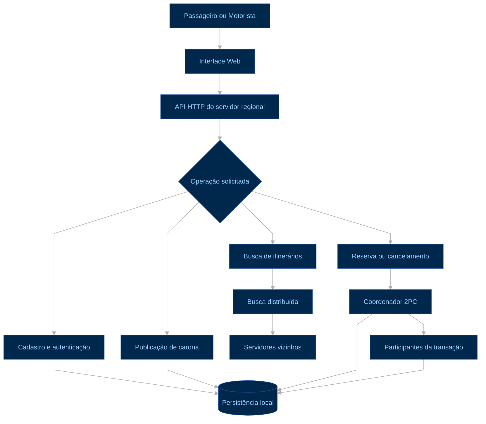
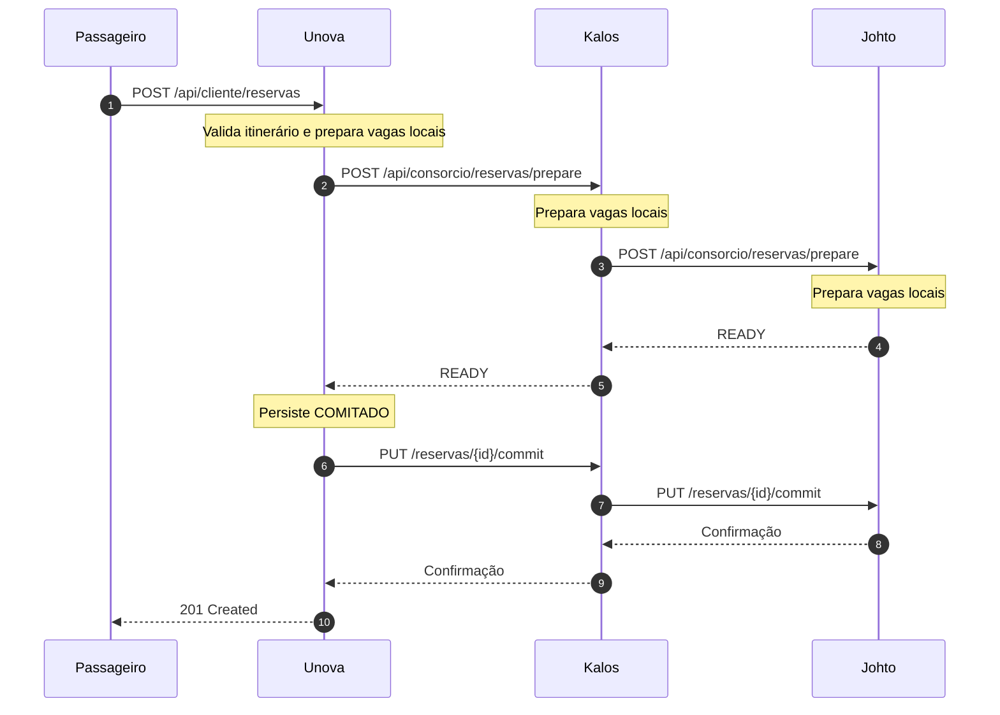
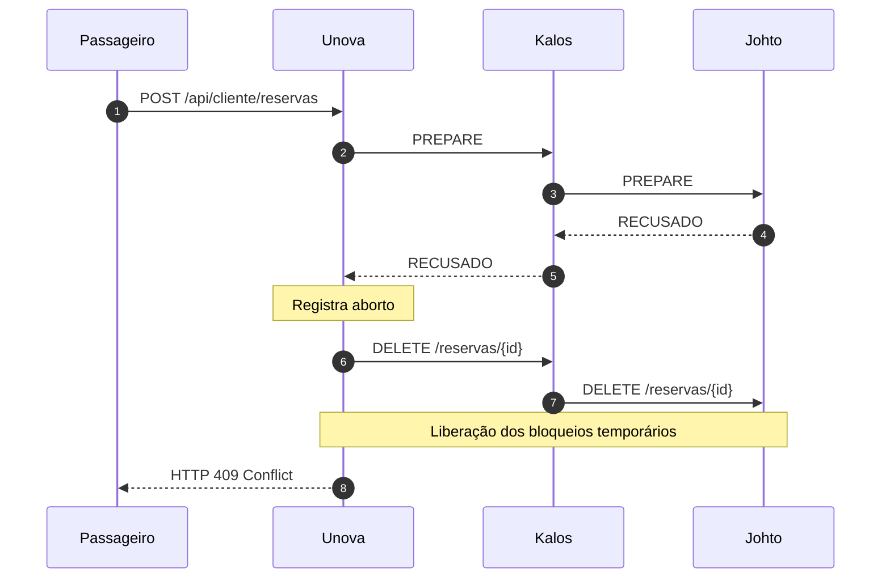
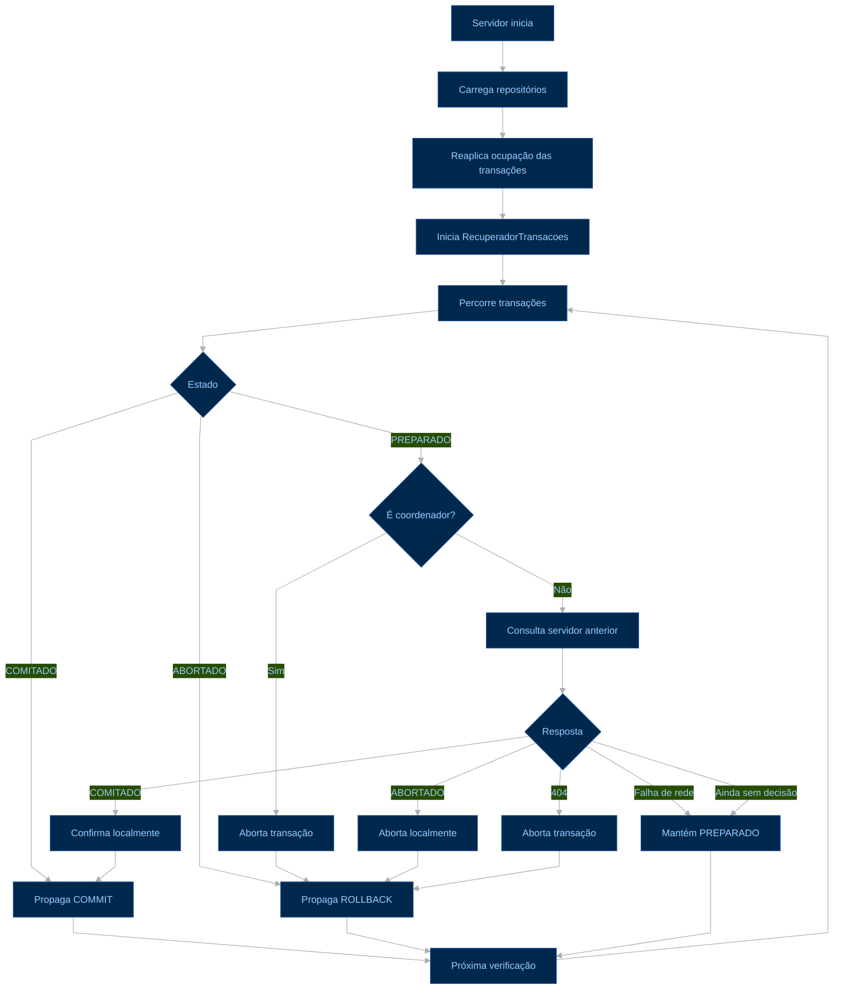

# VaiJunto — Sistema Distribuído de Caronas P2P


O **VaiJunto** é um sistema distribuído de gerenciamento e compartilhamento de caronas. Desenvolvido em Java, o projeto utiliza uma arquitetura *peer-to-peer* (P2P), na qual diferentes servidores administram regiões independentes e cooperam para oferecer serviços de cadastro, publicação de caronas, busca de itinerários e gerenciamento de reservas.

O principal desafio do projeto é permitir que uma operação envolvendo recursos de diferentes servidores seja executada de maneira consistente, mesmo diante de concorrência, falhas de comunicação e reinicializações.

Para isso, o sistema utiliza comunicação HTTP entre os nós, busca distribuída, relógios lógicos de Lamport e o protocolo **Two-Phase Commit (2PC)** para coordenar reservas distribuídas.

Esta documentação descreve a implementação da branch `parte_2`.

---

# Sumário


1. [Funcionamento geral](#1-funcionamento-geral)
2. [Arquitetura e topologia da rede](#2-arquitetura-e-topologia-da-rede)
3. [Tecnologias e requisitos](#3-tecnologias-e-requisitos)
4. [Estrutura do projeto](#4-estrutura-do-projeto)
5. [Compilação](#5-compilação)
6. [Execução do projeto](#6-execução-do-projeto)
7. [Execução dos testes](#7-execução-dos-testes)
8. [Modelo de dados e persistência](#8-modelo-de-dados-e-persistência)
9. [API do cliente](#9-api-do-cliente)
10. [API de comunicação entre servidores](#10-api-de-comunicação-entre-servidores)
11. [Funcionamento das reservas distribuídas](#11-funcionamento-das-reservas-distribuídas)
12. [Concorrência e consistência](#12-concorrência-e-consistência)
13. [Tratamento de falhas e recuperação](#13-tratamento-de-falhas-e-recuperação)
14. [Relógios lógicos de Lamport](#14-relógios-lógicos-de-lamport)
15. [Comparação com a branch main](#15-comparação-com-a-branch-main)
16. [Limitações e considerações](#16-limitações-e-considerações)

---

# 1. Funcionamento geral

O VaiJunto é composto por múltiplos servidores independentes. Cada servidor administra as caronas, os usuários e as transações relacionadas à sua região.

Não existe um servidor central responsável por armazenar todos os dados ou executar todas as operações. Cada nó mantém seu próprio estado local e se comunica com os demais quando uma operação exige informações ou recursos de outras regiões.

A comunicação entre servidores é realizada por meio de requisições HTTP, utilizando uma API REST interna.

## 1.1. Perfis de usuário

O sistema possui dois perfis principais.

### Motorista

O motorista pode:

- Criar uma conta e autenticar-se.
- Cadastrar seus dados de motorista e veículo.
- Publicar caronas em sua região.
- Consultar suas próprias caronas.
- Visualizar a ocupação dos trechos de suas viagens.
- Cancelar uma carona e suas reservas associadas.

Uma carona possui uma rota composta por vários trechos consecutivos. Cada trecho representa um percurso entre duas cidades.

### Passageiro

O passageiro pode:

- Criar uma conta e autenticar-se.
- Consultar itinerários disponíveis.
- Visualizar as informações das caronas que compõem um itinerário.
- Reservar um itinerário, mesmo quando ele envolve servidores diferentes.
- Consultar suas reservas.
- Cancelar uma reserva confirmada.

## 1.2. Organização das caronas

Uma carona pertence a um único servidor, responsável por administrar sua disponibilidade e ocupação.

Uma viagem pode possuir vários trechos:

```text
Cidade A -------- Cidade B -------- Cidade C -------- Cidade D
       Trecho 1          Trecho 2          Trecho 3
```

As vagas são controladas individualmente por trecho. Portanto, dois passageiros podem utilizar partes diferentes da mesma carona sem necessariamente ocupar os mesmos assentos durante toda a viagem.

Por exemplo:

| Passageiro | Origem | Destino |
|---|---|---|
| A | Cidade A | Cidade C |
| B | Cidade B | Cidade D |
| C | Cidade A | Cidade B |

A disponibilidade de cada trecho é controlada separadamente, permitindo o aproveitamento de diferentes partes de uma rota.

## 1.3. Itinerários distribuídos

Um itinerário pode envolver uma ou mais caronas, inclusive administradas por servidores diferentes.

Exemplo:

```text
Passageiro
    |
    v
Unova: Cidade A -> Cidade B
    |
    v
Kalos: Cidade B -> Cidade C
    |
    v
Johto: Cidade C -> Cidade D
```

Nesse caso, cada servidor é responsável por verificar e reservar os recursos de sua própria região.

A busca distribuída consulta os servidores vizinhos para encontrar combinações possíveis de caronas. O resultado contém os trechos que compõem cada itinerário, incluindo o servidor responsável, os horários, os preços e a quantidade de assentos disponíveis.

## 1.4. Fluxo geral do sistema



---

# 2. Arquitetura e topologia da rede

## 2.1. Servidores

A implementação atual possui quatro servidores regionais:

| Identificador | Região | Porta |
|---|---|---:|
| `unova` | Unova | 2602 |
| `kalos` | Kalos | 2603 |
| `johto` | Johto | 2604 |
| `kanto` | Kanto | 2605 |

Os dados de cada região são definidos no arquivo:

```text
Server/src/main/resources/regioes.json
```

Esse arquivo contém:

- Identificador e nome da região.
- Endereço IP padrão.
- Porta de comunicação.
- Cidades pertencentes à região.
- Cidades de conexão externa.
- Identificadores dos servidores vizinhos.

A configuração permite alterar a topologia sem precisar modificar diretamente o código dos serviços de comunicação.

## 2.2. Topologia de comunicação

A topologia configurada atualmente é:

```text
       Unova -------- Kalos
         |              |
         |              |
       Kanto -------- Johto
```

As conexões diretas são:

| Servidor | Vizinhos |
|---|---|
| Unova | Kalos e Kanto |
| Kalos | Unova e Johto |
| Johto | Kalos e Kanto |
| Kanto | Unova e Johto |

Um servidor não deve encaminhar uma requisição diretamente para qualquer outro nó: a comunicação é realizada respeitando as relações de vizinhança definidas na configuração.

## 2.3. Cidades e fronteiras regionais

As cidades são identificadas internamente por números inteiros.

O arquivo `cidades.json` contém o mapeamento entre identificadores e nomes das cidades.

A classe `CidadeMapper` é responsável por:

- Traduzir nomes de cidades para identificadores.
- Traduzir identificadores para nomes.
- Identificar as cidades pertencentes à região atual.
- Identificar as cidades utilizadas como conexões externas.

As conexões externas representam cidades que permitem a ligação entre regiões diferentes.

Por exemplo, uma cidade de fronteira pode aparecer como conexão externa em uma região e pertencer efetivamente a outra. Isso permite que os servidores encontrem itinerários que atravessam as fronteiras regionais.

## 2.4. Descoberta dos servidores

O `ServerConstant` carrega a configuração regional e determina os servidores vizinhos.

Na execução com Docker, os endereços dos servidores são configurados por variáveis de ambiente:

```text
HOST_UNOVA
HOST_KALOS
HOST_JOHTO
HOST_KANTO
```

No `compose.yaml`, essas variáveis apontam para os nomes dos serviços Docker.

Na execução local, os endereços padrão definidos em `regioes.json` são utilizados.

---

# 3. Tecnologias e requisitos

## 3.1. Tecnologias

| Tecnologia | Utilização |
|---|---|
| Java 24 | Linguagem principal |
| Maven | Gerenciamento de dependências e compilação |
| Javalin 7.2.4 | Servidor HTTP e API REST |
| Jackson | Serialização e desserialização JSON |
| Jackson JSR310 | Conversão de tipos de data e hora do Java |
| Logback | Registro de logs |
| SLF4J | Abstração de logging |
| JUnit 5 | Infraestrutura de testes automatizados |
| Mockito | Simulação de dependências nos testes |
| Docker | Isolamento dos servidores |
| Docker Compose | Orquestração dos nós |
| Bash | Execução dos testes de integração |
| cURL | Comunicação HTTP nos testes |
| jq | Manipulação de JSON nos scripts |

## 3.2. Requisitos de ambiente

Para compilar e executar o projeto localmente:

- JDK 24.
- Maven compatível com o projeto.
- Git.
- GNU Make, caso queira utilizar os Makefiles.

Para execução com Docker:

- Docker Engine ou Docker Desktop.
- Docker Compose.

Para executar os scripts de integração:

- Bash.
- cURL.
- jq.

No Windows, recomenda-se utilizar WSL 2 com Ubuntu ou outro ambiente que disponibilize Bash e as ferramentas necessárias.

## 3.3. Versão do Java

O projeto utiliza Java 24.

A versão é configurada no `pom.xml` principal:

```xml
<maven.compiler.source>24</maven.compiler.source>
<maven.compiler.target>24</maven.compiler.target>
```

O plugin de compilação também utiliza:

```xml
<release>24</release>
```

Portanto, é necessário utilizar um JDK compatível com essa versão.

---

# 4. Estrutura do projeto

A organização atual utiliza Maven Multi-Module e possui dois módulos principais: `Shared` e `Server`.

```text
MI_Redes_VaiJunto/
│
├── Shared/
│   ├── pom.xml
│   └── src/main/java/org/UEFS/shared/
│       ├── dto/
│       │   ├── requests/
│       │   ├── responses/
│       │   └── consorcio/
│       ├── enums/
│       ├── model/
│       ├── FileManager.java
│       └── JsonUtils.java
│
├── Server/
│   ├── pom.xml
│   └── src/
│       ├── main/
│       │   ├── java/org/UEFS/Server/
│       │   │   ├── controller/
│       │   │   ├── domain/
│       │   │   │   ├── caronas/
│       │   │   │   ├── cidades/
│       │   │   │   ├── reservas/
│       │   │   │   └── usuarios/
│       │   │   ├── exceptions/
│       │   │   ├── http/
│       │   │   │   ├── cluster/
│       │   │   │   ├── relogio/
│       │   │   │   └── service/
│       │   │   ├── util/
│       │   │   └── Main.java
│       │   │
│       │   └── resources/
│       │       ├── public/
│       │       │   ├── css/
│       │       │   ├── data/
│       │       │   ├── images/
│       │       │   ├── pages/
│       │       │   ├── script/
│       │       │   └── index.html
│       │       ├── regioes.json
│       │       └── logback.xml
│       │
│       └── test/
│
├── Test/
│   ├── comum.sh
│   ├── teste-health.sh
│   └── teste-cadastro-carona.sh
│
├── Dockerfile
├── compose.yaml
├── Makefile
├── Makefile.local
└── pom.xml
```

## 4.1. Módulo Shared

O módulo `Shared` concentra estruturas utilizadas por diferentes partes do sistema.

Entre suas responsabilidades estão:

- DTOs de requisição e resposta.
- DTOs específicos da comunicação entre servidores.
- Enums compartilhados.
- Modelos de dados utilizados na transferência de informações.
- Serialização e desserialização JSON.
- Operações auxiliares de leitura e escrita de arquivos.

A separação evita duplicação de estruturas e mantém os formatos de comunicação consistentes.

### DTOs

Os DTOs representam os dados transferidos pelas APIs.

Alguns exemplos:

| DTO | Responsabilidade |
|---|---|
| `NovaCaronaRequest` | Dados necessários para publicar uma carona. |
| `CadastroRequest` | Dados de cadastro de usuário. |
| `LoginRequest` | Credenciais de autenticação. |
| `ReservaRequest` | Solicitação de reserva distribuída. |
| `TrechoSolicitado` | Identificação de um trecho e do servidor responsável. |
| `BuscaTrechosResponse` | Resultado de uma consulta distribuída. |
| `TrechoConsorcioDTO` | Informações de uma perna de carona retornada pela busca. |
| `ReservaResponse` | Dados de uma reserva apresentada ao passageiro. |

## 4.2. Módulo Server

O módulo `Server` contém a implementação dos servidores regionais.

### `controller/`

Responsável por receber as requisições HTTP e encaminhá-las aos serviços correspondentes.

Entre os principais componentes estão:

- `UserController`: cadastro, login, logout e consulta de usuários.
- `CaronaController`: publicação, consulta e cancelamento de caronas e reservas.
- `ControllerService`: registro e recuperação de serviços utilizados pelos controladores.

### `domain/caronas/`

Contém as regras de negócio relacionadas às caronas.

Principais componentes:

- `Carona`: representa uma viagem publicada por um motorista.
- `Rota`: representa a sequência de trechos da viagem.
- `IdPerna`: auxilia na identificação de trechos reserváveis.
- `CaronaRepo`: repositório de caronas.
- `CaronaService`: operações de negócio relacionadas às caronas.

A ocupação é armazenada por trecho, permitindo controlar a disponibilidade de cada parte de uma viagem.

### `domain/cidades/`

Responsável pelo mapeamento das cidades e pela identificação das fronteiras regionais.

Principais componentes:

- `CidadeJSON`.
- `CidadeMapper`.

### `domain/reservas/`

Implementa o controle das transações e das reservas.

Principais componentes:

- `EstadoTransacao`: enumeração dos estados de uma transação.
- `Transacao`: representa uma operação distribuída.
- `TransacaoRepo`: repositório de transações.
- `TransacaoService`: controla a preparação, confirmação, rollback, cancelamento e recuperação dos recursos locais.

### `domain/usuarios/`

Contém as entidades e os repositórios relacionados aos usuários.

Principais componentes:

- `Usuario`.
- `UserRepo`.

### `http/`

Contém a infraestrutura de comunicação HTTP.

#### `http/cluster/`

Implementa a comunicação com os servidores vizinhos.

- `PeerClient`: realiza as requisições HTTP entre servidores.
- `Repasse`: abstração das operações encaminhadas aos vizinhos.
- `ResultadoRepasse`: representa o resultado de uma operação repassada.

#### `http/relogio/`

Contém os componentes de configuração regional e relógios lógicos.

- `RelogioLamport`: implementa o relógio lógico.
- `ServerConstant`: carrega a região atual, porta, vizinhos e configurações da rede.

#### `http/service/`

Contém os serviços responsáveis pela orquestração das operações distribuídas.

| Classe | Responsabilidade |
|---|---|
| `BuscaDistribuida` | Busca itinerários consultando servidores vizinhos. |
| `ReservaCoordenador` | Coordena o protocolo 2PC iniciado por um cliente. |
| `ReservaParticipante` | Executa as operações de um servidor participante do 2PC. |
| `RecuperadorTransacoes` | Recupera transações pendentes e propaga decisões. |
| `ServerManager` | Integra os serviços distribuídos às rotas HTTP. |
| `ConsorcioUtils` | Utilitários e padronização das respostas do consórcio. |
| `Vizinho` | Representa um servidor vizinho. |
| `Perna` | Representa uma perna local de uma carona. |
| `Preparo` | Resultado da preparação local de uma transação. |
| `Resultado` | Resultado das operações internas. |

### `resources/public/`

Contém a interface web servida pelo próprio servidor.

Os arquivos são organizados em:

- `pages/`: páginas HTML.
- `script/`: funcionalidades JavaScript.
- `css/`: folhas de estilo.
- `data/`: dados utilizados pela interface.
- `images/`: imagens e recursos gráficos.

A interface é disponibilizada pelo Javalin, que também atende às APIs do sistema.

## 4.3. Classe Main

A classe `Main` é responsável por inicializar um servidor regional.

O processo de inicialização segue, em linhas gerais, esta ordem:

1. Lê a região informada por configuração ou argumento.
2. Carrega a topologia e os vizinhos.
3. Inicializa o relógio lógico e o cliente HTTP P2P.
4. Inicializa os repositórios e serviços locais.
5. Inicializa o serviço de transações.
6. Reaplica a ocupação das vagas de transações persistidas.
7. Inicializa o recuperador de transações.
8. Cria os serviços de busca distribuída e coordenação de reservas.
9. Registra os serviços utilizados pelos controladores.
10. Configura o encerramento e a persistência dos dados.
11. Inicia o servidor HTTP.
12. Inicia a recuperação periódica de transações.

Essa sequência é importante porque os serviços dependem dos repositórios e de componentes de comunicação que precisam estar inicializados previamente.

---

# 5. Compilação

O projeto pode ser compilado diretamente com Maven ou por meio dos Makefiles.

## 5.1. Compilação com Maven

Na raiz do projeto:

```bash
mvn -pl Server -am install -DskipTests
```

O parâmetro `-pl Server` seleciona o módulo `Server`.

O parâmetro `-am` solicita que o Maven também compile os módulos dos quais ele depende, neste caso o `Shared`.

O parâmetro `-DskipTests` ignora a execução dos testes.

## 5.2. Compilação com Makefile.local

Também é possível utilizar:

```bash
make -f Makefile.local compile
```

Esse alvo executa a compilação do módulo configurado em `MODULE`, incluindo suas dependências.

Por padrão:

```make
MODULE=Server
```

## 5.3. Limpeza

Para remover os arquivos gerados pela compilação:

```bash
make -f Makefile.local clean
```

Ou diretamente:

```bash
mvn -pl Server -am clean
```

## 5.4. Recompilação completa

Para limpar e compilar novamente:

```bash
make -f Makefile.local rebuild
```

## 5.5. Compilação com Docker

Para construir as imagens:

```bash
make build
```

Para executar apenas a compilação em um contêiner temporário:

```bash
make compile
```

O alvo `compile` executa:

```bash
mvn clean package -DskipTests
```

---

# 6. Execução do projeto

Existem duas formas principais de executar o sistema: utilizando Docker Compose ou iniciando cada servidor diretamente pelo Maven.

# 6.1. Execução com Docker Compose

Essa é a forma recomendada para executar a rede completa, pois os quatro servidores são configurados como serviços independentes.

### Construir as imagens

```bash
make build
```

### Iniciar todos os servidores

```bash
make up
```

O comando executa o Docker Compose em primeiro plano, permitindo acompanhar os logs dos contêineres.

Para iniciar em segundo plano diretamente pelo Docker Compose:

```bash
docker compose -f compose.yaml up -d
```

### Iniciar uma região específica

```bash
make unova
make kalos
make johto
make kanto
```

Cada comando inicia o serviço correspondente.

### Consultar os logs

```bash
make logs
```

### Encerrar os servidores

```bash
make down
```

### Limpar a compilação dentro do Docker

```bash
make clean
```

## 6.2. Portas utilizadas

O Docker Compose disponibiliza as seguintes portas:

| Região | Porta no host | Porta no contêiner |
|---|---:|---:|
| Unova | 2602 | 2602 |
| Kalos | 2603 | 2603 |
| Johto | 2604 | 2604 |
| Kanto | 2605 | 2605 |

Os servidores também compartilham o volume de dados:

```yaml
volumes:
  - ./data:/app/data
```

Cada servidor utiliza um diretório próprio, identificado pela porta.

## 6.3. Execução local com Maven

Para executar sem Docker, utilize o `Makefile.local`.

Opcionalmente, pode-se criar um alias:

```bash
alias mk='make -f Makefile.local'
```

Compile o projeto:

```bash
mk compile
```

Em seguida, abra quatro terminais e inicie os servidores:

```bash
mk unova
```

```bash
mk kalos
```

```bash
mk johto
```

```bash
mk kanto
```

Os atalhos utilizam as seguintes configurações:

| Comando | Região | Porta |
|---|---|---:|
| `mk unova` | Unova | 2602 |
| `mk kalos` | Kalos | 2603 |
| `mk johto` | Johto | 2604 |
| `mk kanto` | Kanto | 2605 |

Os atalhos utilizam o alvo `run-only`, portanto não recompilam o projeto.

Se o código-fonte for alterado, execute novamente:

```bash
mk compile
```

Antes de iniciar os servidores.

### Executar uma região manualmente

Também é possível utilizar os parâmetros:

```bash
mk run REGIAO=Unova PORT=2602
```

Ou iniciar sem recompilar:

```bash
mk run-only REGIAO=Unova PORT=2602
```

A região e sua configuração de porta devem corresponder aos registros de `regioes.json`.

## 6.4. Simulação de falhas

A execução individual dos servidores facilita a simulação de falhas.

Por exemplo:

1. Inicie os quatro servidores.
2. Realize uma busca ou reserva distribuída.
3. Encerre um dos servidores com `Ctrl + C`.
4. Observe os timeouts e as mensagens de falha de comunicação.
5. Reinicie o servidor.
6. Observe a recuperação das transações persistidas e a reconciliação dos estados.

A simulação permite observar o comportamento do sistema diante da indisponibilidade temporária de um participante.

---

# 7. Execução dos testes

Os scripts de integração estão localizados no diretório `Test/`.

Eles utilizam Bash, cURL e jq para realizar requisições HTTP e validar as respostas dos servidores.

## 7.1. Dependências

Verifique se as ferramentas estão disponíveis:

```bash
bash --version
curl --version
jq --version
```

## 7.2. Teste de disponibilidade

Arquivo:

```text
Test/teste-health.sh
```

Execução:

```bash
bash Test/teste-health.sh
```

O teste consulta o endpoint de saúde dos quatro servidores:

```http
GET /api/consorcio/health
```

Para cada servidor, verifica:

- Se a conexão HTTP foi estabelecida.
- Se o servidor retornou uma resposta válida.
- Se o campo `status` está presente.
- Se o relógio lógico foi retornado.

O teste considera a rede disponível quando todos os quatro servidores respondem corretamente.

## 7.3. Teste de cadastro e criação de carona

Arquivo:

```text
Test/teste-cadastro-carona.sh
```

Execução:

```bash
bash Test/teste-cadastro-carona.sh
```

O script executa um fluxo de integração envolvendo:

1. Cadastro de um motorista.
2. Verificação do token retornado.
3. Cadastro do perfil de motorista.
4. Criação de uma carona em Unova.
5. Consulta das caronas do motorista.
6. Cadastro de um passageiro.
7. Consulta inicial das reservas.
8. Solicitação de uma reserva local.
9. Verificação da confirmação da transação.
10. Consulta das reservas após a confirmação.

O teste valida, entre outros pontos:

- Cadastro e autenticação.
- Proteção das rotas.
- Publicação de caronas.
- Consulta de caronas.
- Criação de reservas.
- Execução do fluxo local de 2PC.
- Persistência e consulta do estado da reserva.

## 7.4. Arquivo comum dos testes

O arquivo:

```text
Test/comum.sh
```

concentra funções auxiliares utilizadas pelos scripts.

Entre elas:

| Função | Responsabilidade |
|---|---|
| `health` | Consulta a saúde de um servidor. |
| `aguardar_servidor` | Aguarda um servidor ficar disponível. |
| `verificar_rede` | Verifica os quatro servidores. |
| `consultar_transacao` | Consulta o estado de uma transação. |
| `api_json` | Executa uma requisição HTTP e armazena status e corpo. |
| `exigir_status` | Valida o código HTTP recebido. |
| `exigir_json` | Valida uma condição sobre a resposta JSON. |
| `falhar` | Encerra o teste indicando uma falha. |
| `sucesso` | Exibe uma mensagem de sucesso. |

A URL-base pode ser configurada pela variável `BASE_URL`.

Por padrão:

```bash
BASE_URL=http://localhost
```

Exemplo:

```bash
BASE_URL=http://127.0.0.1 bash Test/teste-health.sh
```

## 7.5. Testes Maven

O projeto também possui dependências de teste configuradas no Maven, incluindo JUnit 5 e Mockito.

Para executar os testes Maven:

```bash
make -f Makefile.local test
```

Ou:

```bash
mvn -pl Server -am test
```

Os testes Maven são diferentes dos scripts Bash de integração: os primeiros executam testes automatizados do projeto, enquanto os segundos validam o comportamento dos servidores por meio de requisições HTTP reais.

---

# 8. Modelo de dados e persistência

O sistema não utiliza um banco de dados centralizado.

Cada servidor mantém seus próprios dados em arquivos JSON, separados por região.

A persistência é realizada pelos repositórios, que utilizam o `FileManager` e o `JsonUtils` para ler e escrever os dados.

## 8.1. Organização dos arquivos

Os arquivos são armazenados em diretórios identificados pela porta do servidor:

```text
data/
├── 2602/
│   ├── usuarios.json
│   ├── caronas.json
│   └── transacoes.json
│
├── 2603/
│   ├── usuarios.json
│   ├── caronas.json
│   └── transacoes.json
│
├── 2604/
│   ├── usuarios.json
│   ├── caronas.json
│   └── transacoes.json
│
└── 2605/
    ├── usuarios.json
    ├── caronas.json
    └── transacoes.json
```

Cada servidor possui seus próprios registros.

Isso significa que o servidor Unova não precisa manter uma cópia completa dos dados de Kalos, Johto ou Kanto.

Quando uma operação depende de informações remotas, os dados são obtidos por comunicação entre os servidores.

## 8.2. Usuários

O repositório `UserRepo` mantém os usuários da região.

Além do armazenamento por identificador, mantém um índice por e-mail para facilitar a autenticação e a verificação de cadastros duplicados.

Arquivo:

```text
usuarios.json
```

## 8.3. Caronas

O repositório `CaronaRepo` mantém as caronas publicadas na região.

Arquivo:

```text
caronas.json
```

Uma carona armazena, entre outras informações:

- Identificador.
- Identificador do motorista.
- Rota.
- Data de partida.
- Quantidade total de vagas.
- Valor por trecho.
- Estado da carona.
- Ocupação de cada trecho.

A ocupação é representada por um mapa que associa cada trecho ao conjunto de passageiros que o utilizam.

## 8.4. Transações

O repositório `TransacaoRepo` mantém as transações distribuídas conhecidas pelo servidor.

Arquivo:

```text
transacoes.json
```

Cada transação armazena:

- Identificador único.
- Identificador do coordenador.
- Servidor anterior na cadeia.
- Próximo servidor na cadeia.
- Identificador do passageiro.
- Relógio lógico.
- Data de criação.
- Trechos locais reservados.
- Itinerário completo, quando disponível.
- Estado atual da transação.

A separação entre `locais` e `itinerario` é importante.

`locais` contém somente os trechos pertencentes ao servidor atual, incluindo os assentos efetivamente reservados nele.

`itinerario` representa o itinerário completo da reserva, permitindo que o coordenador armazene e apresente o resultado global.

## 8.5. Persistência durante o encerramento

A classe `Main` registra um *shutdown hook*.

Quando o processo recebe um sinal de encerramento, o sistema:

1. Encerra o recuperador periódico de transações.
2. Salva os usuários.
3. Salva as caronas.
4. Salva as transações.

Além disso, operações importantes persistem seus dados durante a execução, não dependendo exclusivamente do encerramento do servidor.

No Docker, o diretório `data/` é montado como volume para que os arquivos não fiquem restritos ao ciclo de vida do contêiner.

---

# 9. API do cliente

A API do cliente é utilizada pela interface web e por aplicações externas que desejem consumir os serviços do VaiJunto.

Prefixo principal:

```text
/api/cliente
```

As rotas são implementadas no `HttpServer` e encaminhadas aos controladores e serviços correspondentes.

## 9.1. Autenticação

### Cadastro

```http
POST /api/cliente/cadastro
Content-Type: application/json
```

Cria uma conta de usuário.

Payload:

```json
{
  "email": "usuario@exemplo.com",
  "senha": "senha123",
  "nome": "Nome do Usuário"
}
```

O cadastro retorna os dados de autenticação e do usuário, incluindo um token de sessão.

O token é utilizado nas operações protegidas.

### Login

```http
POST /api/cliente/login
Content-Type: application/json
```

Payload:

```json
{
  "email": "usuario@exemplo.com",
  "senha": "senha123"
}
```

Realiza a autenticação e retorna os dados do usuário e seu token.

Se uma sessão já existir para o usuário, o sistema pode reutilizá-la.

### Logout

```http
POST /api/cliente/logout
Authorization: Bearer <TOKEN>
```

Encerra a sessão associada ao token informado.

### Consultar usuário autenticado

```http
GET /api/cliente/eu
Authorization: Bearer <TOKEN>
```

Retorna os dados do usuário associado à sessão atual.

### Cadastro de motorista

```http
POST /api/cliente/cadastro/motorista
Authorization: Bearer <TOKEN>
Content-Type: application/json
```

Transforma um usuário passageiro em motorista, cadastrando os dados necessários do veículo.

Payload:

```json
{
  "cnh": "12345678900",
  "placaCarro": "ABC1D23",
  "modeloCarro": "Modelo do veículo",
  "corCarro": "Preto"
}
```

A operação exige um usuário autenticado.

## 9.2. Consulta de itinerários

```http
GET /api/cliente/itinerarios?origem=<ORIGEM>&destino=<DESTINO>
Authorization: Bearer <TOKEN>
```

Consulta itinerários entre duas cidades.

Os parâmetros `origem` e `destino` são nomes de cidades.

Exemplo:

```http
GET /api/cliente/itinerarios?origem=Castelia&destino=Lumiose%20City
```

O servidor executa a busca local e consulta os servidores vizinhos quando necessário.

A resposta contém:

- Identificador do servidor que iniciou a busca.
- Quantidade de itinerários encontrados.
- Lista de itinerários.
- Identificador de cada itinerário.
- Preço total.
- Lista de trechos que compõem o percurso.

Exemplo simplificado:

```json
{
  "servidor": "unova",
  "total": 1,
  "itinerarios": [
    {
      "itinerario_id": "itinerario-1",
      "preco_total": 80.0,
      "trechos": [
        {
          "servidor": "unova",
          "id_carona": "carona_1.Castelia-Lumiose",
          "origem": "Castelia",
          "destino": "Lumiose City",
          "horario": "2026-11-02T08:00:00",
          "preco": 80.0,
          "assentos_livres": 3,
          "paradas_intermediarias": []
        }
      ]
    }
  ]
}
```

Os valores do exemplo são ilustrativos.

### Informações de cada trecho

| Campo | Descrição |
|---|---|
| `servidor` | Servidor responsável pela carona. |
| `id_carona` | Identificador da perna reservável. |
| `origem` | Nome da cidade de origem. |
| `destino` | Nome da cidade de destino. |
| `horario` | Data e horário de partida. |
| `preco` | Preço da perna. |
| `assentos_livres` | Quantidade de assentos disponíveis. |
| `paradas_intermediarias` | Cidades intermediárias percorridas pela mesma carona. |

As paradas intermediárias não representam necessariamente uma baldeação. Elas podem fazer parte de uma única carona.

## 9.3. Consulta de caronas do motorista

```http
GET /api/cliente/caronas
Authorization: Bearer <TOKEN>
```

Retorna as caronas publicadas pelo motorista autenticado.

Antes de apresentar os dados, o serviço também pode realizar uma sincronização do estado das caronas com o servidor responsável.

A resposta contém informações como:

```json
{
  "id": "carona-1",
  "idMotorista": "usuario-1",
  "vagasTotais": 3,
  "data": "2026-11-02T08:00:00",
  "status": "AGENDADA",
  "ocupacaoPorTrecho": []
}
```

A estrutura de ocupação contém os passageiros associados a cada trecho.

## 9.4. Publicação de carona

```http
POST /api/cliente/caronas
Authorization: Bearer <TOKEN>
Content-Type: application/json
```

Publica uma nova carona no servidor regional atual.

Payload:

```json
{
  "idMotorista": "usuario-1",
  "vagas": 3,
  "valorPorTrecho": 15.5,
  "dataPartida": "2026-11-02T08:00:00",
  "trechos": [
    {
      "origem": 101,
      "destino": 102
    },
    {
      "origem": 102,
      "destino": 103
    }
  ]
}
```

O campo `dataPartida` utiliza o formato:

```text
yyyy-MM-dd'T'HH:mm:ss
```

O servidor verifica se o usuário autenticado é motorista e se o identificador informado em `idMotorista` corresponde ao proprietário do token.

Também verifica se a cidade de origem inicial pertence à região administrada pelo servidor.

Em caso de sucesso, a resposta utiliza HTTP `201 Created`.

## 9.5. Compatibilidade com rotas

Existe também uma rota alternativa para publicação:

```http
POST /api/cliente/rotas
Authorization: Bearer <TOKEN>
Content-Type: application/json
```

Ela utiliza o mesmo controlador de criação de caronas.

## 9.6. Cancelamento de carona

```http
DELETE /api/cliente/caronas/{id}
Authorization: Bearer <TOKEN>
```

Cancela uma carona pertencente ao motorista autenticado.

A operação também trata as transações e reservas associadas à viagem.

Resposta simplificada:

```json
{
  "mensagem": "Carona e reservas associadas canceladas"
}
```

## 9.7. Consulta de reservas

```http
GET /api/cliente/reservas
Authorization: Bearer <TOKEN>
```

Retorna as reservas do passageiro autenticado.

A resposta contém:

- Identificador da reserva.
- Itinerário.
- Trechos envolvidos.
- Estado apresentado ao passageiro.

Exemplo simplificado:

```json
[
  {
    "idReserva": "transacao-1",
    "itinerario": {
      "passos": []
    },
    "status": "ATIVA"
  }
]
```

Os estados apresentados ao cliente são diferentes dos estados internos utilizados pelo protocolo 2PC.

## 9.8. Solicitação de reserva

```http
POST /api/cliente/reservas
Authorization: Bearer <TOKEN>
Content-Type: application/json
```

Inicia uma reserva distribuída.

Payload:

```json
{
  "trechos_solicitados": [
    {
      "servidor": "unova",
      "id_carona": "carona_1_101_102"
    },
    {
      "servidor": "kalos",
      "id_carona": "carona_2_102_103"
    }
  ]
}
```

Cada elemento identifica:

- O servidor responsável pelo trecho.
- O identificador da perna reservável.

O servidor que recebe a requisição atua como coordenador da transação.

O identificador do passageiro é obtido a partir do token, não sendo necessário enviá-lo no payload do cliente.

Em caso de confirmação, a resposta utiliza HTTP `201 Created`:

```json
{
  "id_transacao": "uuid-da-transacao",
  "status": "CONFIRMADO",
  "passageiro": "usuario-1",
  "relogio_logico": 42,
  "trechos": []
}
```

Se algum participante não conseguir preparar a reserva, o coordenador inicia o rollback.

## 9.9. Cancelamento de reserva

```http
DELETE /api/cliente/reservas/{id}
Authorization: Bearer <TOKEN>
```

Cancela uma reserva pertencente ao passageiro autenticado.

O servidor verifica se a reserva pertence ao usuário antes de permitir o cancelamento.

A operação libera os recursos locais e inicia a propagação da notificação aos servidores envolvidos.

A resposta contém a lista atualizada de reservas do passageiro.

## 9.10. Consulta das cidades do servidor

```http
GET /api/servidor/cidades
```

Retorna o mapeamento das cidades disponibilizadas pela configuração regional do servidor.

A resposta utiliza identificadores numéricos como chaves e nomes de cidades como valores.

---

# 10. API de comunicação entre servidores

Prefixo:

```text
/api/consorcio
```

Essa API é destinada à comunicação interna entre os servidores do consórcio.

Ela é utilizada pelos componentes `PeerClient`, `ReservaCoordenador`, `ReservaParticipante`, `BuscaDistribuida` e `RecuperadorTransacoes`.

## 10.1. Cabeçalhos de comunicação

As requisições entre servidores incluem:

| Header | Descrição |
|---|---|
| `X-Server-Id` | Identificador do servidor remetente. |
| `X-Lamport-Clock` | Valor do relógio lógico do remetente. |
| `Content-Type` | Tipo de conteúdo, normalmente `application/json`. |
| `Accept` | Tipo de resposta esperado. |

Exemplo:

```http
X-Server-Id: unova
X-Lamport-Clock: 42
Content-Type: application/json
Accept: application/json
```

As respostas da API também incluem `X-Server-Id` e `X-Lamport-Clock`.

Esses cabeçalhos são utilizados para identificar a origem da mensagem e atualizar os relógios lógicos.

## 10.2. Monitoramento

### Verificar saúde do servidor

```http
GET /api/consorcio/health
```

Retorna informações básicas sobre o servidor e seu relógio lógico.

Exemplo:

```json
{
  "status": "unova ta on",
  "relogio": 42
}
```

### Verificação alternativa

```http
GET /api/consorcio/vivo
```

Utiliza o mesmo método de verificação de saúde.

## 10.3. Consulta de usuário remoto

```http
GET /api/consorcio/usuarios/{id}
```

Permite consultar informações públicas de um usuário administrado por outro servidor.

É utilizada, por exemplo, quando um motorista precisa apresentar informações de passageiros que não estão cadastrados localmente.

## 10.4. Busca remota de trechos

```http
GET /api/consorcio/trechos?origem=<ORIGEM>&destino=<DESTINO>&visitados=<SERVIDORES>
```

É utilizada pelos servidores durante a busca distribuída.

Parâmetros:

| Parâmetro | Descrição |
|---|---|
| `origem` | Cidade a partir da qual a busca deve continuar. |
| `destino` | Cidade de destino desejada. |
| `visitados` | Lista de servidores já visitados, separada por vírgulas. |

O parâmetro `visitados` auxilia na prevenção de ciclos e consultas repetidas.

A resposta utiliza a estrutura `BuscaTrechosResponse`, contendo o servidor responsável, o total de itinerários e os itinerários encontrados.

## 10.5. Preparação de uma reserva

```http
POST /api/consorcio/reservas/prepare
Content-Type: application/json
```

É a primeira fase do protocolo 2PC.

O servidor recebe os dados da transação, identifica os trechos de sua responsabilidade e tenta bloquear as vagas correspondentes.

Payload:

```json
{
  "id_transacao": "uuid-da-transacao",
  "coordenador_id": "unova",
  "passageiro": "usuario-1",
  "relogio_logico": 42,
  "trechos_solicitados": [
    {
      "servidor": "kalos",
      "id_carona": "carona_2_102_103"
    },
    {
      "servidor": "johto",
      "id_carona": "carona_3_103_104"
    }
  ]
}
```

O campo `id_transacao` identifica a operação em todos os participantes.

O campo `coordenador_id` identifica o servidor que iniciou a reserva.

O campo `passageiro` identifica o usuário responsável pela solicitação.

O campo `relogio_logico` transporta o timestamp lógico associado à operação.

O campo `trechos_solicitados` contém os trechos ainda não processados pela cadeia.

Quando consegue preparar sua parte, o servidor encaminha os trechos restantes ao próximo vizinho.

Uma resposta de preparação bem-sucedida utiliza HTTP `200 OK` e o estado `READY`.

Exemplo simplificado:

```json
{
  "id_transacao": "uuid-da-transacao",
  "status": "READY",
  "servidor": "kalos",
  "assentos": []
}
```

Se não conseguir reservar os recursos, retorna uma resposta de recusa com o motivo e o código HTTP correspondente.

## 10.6. Confirmação de transação

```http
PUT /api/consorcio/reservas/{id}/commit
```

É a segunda fase do 2PC.

O servidor recebe a decisão de confirmação e registra o estado `COMITADO`.

Em seguida, encaminha a decisão ao próximo servidor da cadeia.

O commit só pode ser aplicado a uma transação que esteja preparada, respeitando a decisão persistida.

A operação é idempotente: receber novamente uma confirmação já registrada não deve criar uma segunda reserva.

## 10.7. Rollback

```http
DELETE /api/consorcio/reservas/{id}
```

Desfaz uma transação que ainda esteja no estado `PREPARADO`.

O servidor:

1. Localiza a transação.
2. Verifica se ela pode ser desfeita.
3. Libera os assentos reservados localmente.
4. Registra o estado `ABORTADO`.
5. Persiste a alteração.
6. Propaga o rollback ao próximo servidor.

Uma transação já confirmada não pode ser revertida por esse endpoint.

Se a transação já estiver abortada, a operação pode ser repetida sem liberar os mesmos recursos novamente.

## 10.8. Cancelamento de reserva confirmada

```http
PUT /api/consorcio/reservas/{id}/cancel
```

É diferente do rollback.

O rollback desfaz uma preparação que ainda não foi confirmada.

O cancelamento trata uma reserva que já foi confirmada e precisa ser desativada posteriormente.

Essa operação propaga a decisão de cancelamento aos participantes envolvidos.

## 10.9. Consulta do estado de uma transação

```http
GET /api/consorcio/reservas/{id}/status
```

Retorna o estado atual da transação conhecida pelo servidor.

É utilizada pelo mecanismo de recuperação e pelo Lazy Check.

Uma resposta simplificada pode conter:

```json
{
  "id_transacao": "uuid-da-transacao",
  "status": "COMITADO"
}
```

A ausência de uma transação é representada por HTTP `404 Not Found`.

---

# 11. Funcionamento das reservas distribuídas

A reserva distribuída utiliza o protocolo **Two-Phase Commit (2PC)** em uma organização encadeada.

O servidor que recebe a requisição do cliente atua como coordenador. Os servidores que possuem os demais trechos participam da transação.

## 11.1. Identificação da transação

Ao receber uma solicitação válida, o coordenador:

1. Obtém o identificador do passageiro por meio do token.
2. Valida o itinerário solicitado.
3. Verifica a sequência dos servidores.
4. Confere se os servidores envolvidos respeitam a topologia.
5. Gera um identificador único para a transação.
6. Obtém um timestamp do relógio de Lamport.
7. Cria o registro local da transação.

O identificador da transação é utilizado por todos os participantes para reconhecer a mesma operação.

## 11.2. Fase 1 — Prepare

Na primeira fase, cada servidor tenta reservar temporariamente os trechos de sua responsabilidade.

O coordenador começa preparando os trechos locais.

Se a preparação local for bem-sucedida, encaminha os trechos restantes ao próximo servidor.

O participante executa o mesmo procedimento:

1. Valida a solicitação recebida.
2. Identifica os trechos locais.
3. Verifica a disponibilidade das vagas.
4. Bloqueia os recursos.
5. Persiste a transação.
6. Encaminha os trechos restantes, se existirem.

Quando todos os servidores envolvidos conseguem preparar a operação, a resposta `READY` retorna pela cadeia até o coordenador.

Durante essa fase, as vagas ficam ocupadas temporariamente.

## 11.3. Fase 2 — Commit

Quando todos os participantes respondem positivamente, o coordenador registra a decisão `COMITADO`.

A decisão é persistida localmente antes de ser propagada aos demais servidores.

Depois disso, o coordenador envia o commit ao próximo participante.

Cada participante:

1. Localiza a transação.
2. Verifica seu estado.
3. Registra o commit.
4. Persiste a decisão.
5. Propaga a confirmação ao próximo servidor.

Ao final, todos os participantes devem possuir a mesma decisão final.

## 11.4. Rollback

Se algum servidor recusar a preparação, o coordenador inicia o rollback.

O procedimento percorre os participantes que já prepararam recursos, liberando as vagas temporárias.

Exemplo:

```text
Coordenador: Unova
Participante: Kalos
Participante: Johto

Unova  -> PREPARE -> Kalos
Kalos  -> PREPARE -> Johto
Johto  -> RECUSADO

Unova  -> ROLLBACK -> Kalos
Kalos  -> ROLLBACK -> Johto
```

O resultado esperado é que nenhum trecho da reserva permaneça parcialmente confirmado.

## 11.5. Diagrama de sequência — Reserva confirmada



## 11.6. Diagrama de sequência — Reserva recusada



---

# 12. Concorrência e consistência

O controle de concorrência é essencial para impedir que diferentes passageiros reservem a mesma vaga simultaneamente.

## 12.1. Sincronização local

O `TransacaoService` utiliza sincronização sobre o `CaronaService` para coordenar operações que modificam a ocupação das caronas.

A preparação de uma transação é executada dentro de uma região sincronizada.

Isso evita que duas operações locais modifiquem simultaneamente os mesmos recursos de maneira incompatível.

## 12.2. Ocupação por trecho

A classe `Carona` mantém a ocupação de cada trecho.

A operação de ocupação verifica:

- Se a carona continua aberta.
- Se o trecho pertence à rota.
- Se o passageiro já está naquele trecho.
- Se ainda existe vaga disponível.

O resultado da operação é representado por `Carona.Ocupacao`.

Entre os resultados possíveis estão:

- `OK`.
- `CARONA_FECHADA`.
- `TRECHO_INEXISTENTE`.
- `SEM_VAGA`.
- `JA_NO_TRECHO`.

## 12.3. Preparação atômica local

Uma transação pode envolver vários trechos pertencentes ao mesmo servidor.

Se a preparação conseguir ocupar alguns trechos, mas falhar em outro, o serviço libera os recursos que já haviam sido ocupados naquela tentativa.

Assim, uma falha local não deve deixar apenas parte dos trechos da mesma transação bloqueada.

## 12.4. Idempotência

As operações distribuídas podem ser repetidas em decorrência de timeouts, respostas perdidas ou tentativas de recuperação.

Por isso, o sistema verifica se uma transação já existe antes de executar determinadas operações.

Exemplos:

- Um `PREPARE` repetido pode reconhecer uma transação já preparada ou confirmada.
- Um `COMMIT` repetido não deve duplicar a reserva.
- Um `ROLLBACK` repetido de uma transação já abortada não deve liberar novamente os mesmos assentos.
- Um rollback de uma transação confirmada é recusado.

Essas verificações são importantes porque uma falha de comunicação não permite concluir com certeza que a operação remota deixou de ser executada.

---

# 13. Tratamento de falhas e recuperação

A arquitetura precisa lidar com situações em que um servidor fica indisponível, uma resposta é perdida ou um processo é encerrado durante uma transação.

O projeto utiliza persistência local, timeouts, operações idempotentes, propagação de decisões e mecanismos de reconciliação.

## 13.1. Falhas de comunicação

O `PeerClient` é responsável pelas requisições HTTP entre os servidores.

As requisições possuem limites de tempo de espera, evitando que uma operação fique aguardando indefinidamente por um servidor indisponível.

Entre os tempos configurados estão:

| Operação | Timeout aproximado |
|---|---:|
| Conexão HTTP | 3 segundos |
| Busca remota | 2 segundos |
| Requisição de preparação | 2 segundos por etapa, considerando o número de servidores restantes |
| Consulta de estado | 2 segundos |
| Propagação de commit ou rollback | 2 segundos |

Quando ocorre uma falha de comunicação, o `PeerClient` registra o problema e permite que o serviço chamador tome uma decisão apropriada.

O cliente também mantém uma indicação temporária de servidores suspeitos. A busca distribuída pode evitar consultar um vizinho marcado como suspeito até que o período de suspeita expire.

## 13.2. Diferença entre timeout e recusa

Um timeout não significa necessariamente que o servidor remoto deixou de executar a operação.

Considere a seguinte situação:

1. Unova envia um `PREPARE` para Kalos.
2. Kalos recebe a requisição.
3. Kalos bloqueia as vagas e persiste a transação.
4. Kalos envia `READY`.
5. A resposta se perde durante a comunicação.

Unova não sabe se Kalos executou a operação.

Portanto, uma falha de comunicação deve ser tratada de maneira diferente de uma recusa explícita.

O sistema utiliza o identificador da transação e as operações idempotentes para lidar com novas tentativas e reconciliar o estado posteriormente.

## 13.3. Persistência antes da propagação

Um dos pontos importantes do protocolo é a ordem entre persistência e comunicação.

A decisão de commit é gravada localmente antes da propagação aos participantes.

Isso permite que o coordenador recupere a decisão após uma reinicialização, mesmo que não tenha conseguido enviar a mensagem a todos os servidores.

O mesmo princípio é utilizado no registro dos estados de preparação e aborto.

## 13.4. Estados das transações

A enumeração `EstadoTransacao` possui os seguintes estados:

| Estado | Significado |
|---|---|
| `PREPARADO` | Recursos reservados temporariamente, aguardando decisão. |
| `COMITADO` | Reserva confirmada pelo protocolo 2PC. |
| `ABORTADO` | Transação desfeita antes da confirmação. |
| `CANCELANDO` | Cancelamento em andamento. |
| `CANCELADO_PELO_MOTORISTA` | Reserva cancelada em decorrência de uma ação do motorista. |
| `CANCELADO_PELO_PASSAGEIRO` | Reserva cancelada pelo passageiro. |

Os três primeiros estados representam o ciclo principal do 2PC.

Os demais representam situações relacionadas ao cancelamento de reservas já confirmadas.

## 13.5. Recuperação após reinicialização

Durante a inicialização, o `Main` executa:

```java
transacoes.reaplicarOcupacao();
```

Esse método percorre as transações persistidas e reaplica a ocupação das vagas para transações nos estados:

- `PREPARADO`.
- `COMITADO`.

Isso é importante porque o arquivo de caronas e o arquivo de transações podem ter sido gravados em momentos diferentes.

O registro da transação permite reconstruir a ocupação que deve existir após a reinicialização.

## 13.6. Recuperador periódico

A classe `RecuperadorTransacoes` executa verificações periódicas.

O agendador realiza uma primeira execução imediatamente e, depois, repete o processo com intervalo de cinco segundos.

O comportamento depende do estado da transação.

### Transações COMITADO

Se a transação já está confirmada, o recuperador tenta propagar novamente a decisão de commit ao próximo servidor.

Isso permite concluir uma confirmação cuja propagação tenha falhado anteriormente.

### Transações ABORTADO

Se a transação foi abortada, o recuperador tenta propagar novamente o rollback.

Assim, participantes que não receberam a decisão inicialmente podem ser atualizados posteriormente.

### Transações PREPARADO

O tratamento depende do papel do servidor.

**Se o servidor for o coordenador:**

O coordenador não possui um servidor anterior responsável por tomar a decisão por ele.

Se encontrar uma transação própria ainda em `PREPARADO` durante a recuperação, ela é abortada.

**Se o servidor for participante:**

O participante consulta o servidor anterior da cadeia para descobrir a decisão da transação.

O comportamento é:

| Resultado da consulta | Ação |
|---|---|
| Anterior responde `COMITADO` | Confirma localmente e propaga o commit. |
| Anterior responde `ABORTADO` | Aborta localmente e propaga o rollback. |
| Anterior retorna `404` | Aborta, pois o servidor anterior não conhece a transação. |
| Falha de comunicação | Mantém a transação preparada e tenta novamente posteriormente. |
| Estado ainda não decidido | Mantém a transação preparada. |

Essa estratégia permite que os participantes recuperem decisões que não conseguiram receber durante uma falha de comunicação.

## 13.7. Diagrama de recuperação



## 13.8. Push assíncrono

O sistema também utiliza notificações assíncronas para propagar cancelamentos.

Quando uma reserva ou carona é cancelada, o servidor responsável inicia a comunicação com os demais servidores envolvidos.

A propagação assíncrona evita que a resposta ao cliente dependa da conclusão imediata de todas as notificações remotas.

Entretanto, como a comunicação pode falhar, o Push não é suficiente para garantir que todos os nós estejam atualizados no mesmo instante.

## 13.9. Lazy Check (Pull sob demanda)

O Lazy Check complementa a propagação assíncrona.

Em vez de depender exclusivamente de notificações, o servidor consulta o responsável pela informação quando precisa verificar se seu estado local continua atualizado.

O mecanismo aparece em dois contextos principais.

**Consulta de caronas pelo motorista**

Antes de apresentar as caronas, o sistema pode executar `sincronizarPorCarona(idCarona)` para verificar se houve alguma alteração no servidor responsável.

**Consulta de reservas pelo passageiro**

Ao consultar as reservas, o sistema pode executar `sincronizarStatus(tx)` para consultar o coordenador da transação e atualizar o estado local.

Dessa forma, uma notificação perdida pode ser compensada por uma consulta posterior.

## 13.10. Diferença entre recuperação e sincronização

Os mecanismos possuem responsabilidades diferentes:

| Mecanismo | Objetivo |
|---|---|
| Persistência JSON | Preservar o estado local após reinicializações. |
| `reaplicarOcupacao()` | Reconstruir a ocupação das vagas a partir das transações. |
| `RecuperadorTransacoes` | Resolver transações pendentes e propagar decisões do 2PC. |
| Push assíncrono | Notificar outros servidores sobre alterações. |
| Lazy Check | Consultar o estado remoto quando necessário e reconciliar informações. |
| Idempotência | Permitir repetição de operações sem duplicar efeitos. |

---

# 14. Relógios lógicos de Lamport

Os servidores utilizam relógios lógicos de Lamport para acompanhar a ordem dos eventos distribuídos.

O relógio é implementado na classe `RelogioLamport`, utilizando um `AtomicInteger`.

## 14.1. Incremento local

Quando um evento local precisa receber um timestamp, o relógio é incrementado:

```java
public int tique() {
    return tempo.incrementAndGet();
}
```

## 14.2. Recebimento de mensagem

Quando uma mensagem chega com um timestamp remoto, o relógio é atualizado:

```java
public int atualizar(int tempoRecebido) {
    return tempo.updateAndGet(
        T -> Math.max(T, tempoRecebido) + 1
    );
}
```

A regra é:

\[
L = \max(L_{\text{local}}, L_{\text{recebido}}) + 1
\]

Isso preserva a relação de causalidade entre os eventos.

## 14.3. Comunicação HTTP

O relógio é transportado pelo cabeçalho:

```http
X-Lamport-Clock: 42
```

Ao receber uma requisição, o servidor atualiza seu relógio.

Ao responder, inclui seu valor atualizado no cabeçalho da resposta.

O `PeerClient` também lê o valor recebido e atualiza o relógio local.

## 14.4. Uso nas transações

Ao iniciar uma reserva distribuída, o coordenador obtém um timestamp lógico.

Esse valor é armazenado na transação e enviado aos participantes.

O timestamp permite relacionar a operação com os eventos de comunicação que ocorreram durante sua execução.

O relógio lógico não representa o horário físico exato. Seu objetivo é estabelecer uma ordenação coerente dos eventos distribuídos.

---

# 15. Comparação com a branch main

A branch `parte_2` representa uma mudança arquitetural significativa em relação à versão disponível na `main`.

A comparação entre as branches mostra que `parte_2` possui 15 commits à frente e 1 commit atrás da `main`, com histórico divergente.

Portanto, as diferenças abaixo consideram o estado das duas branches e não apenas uma sequência linear de alterações.

## 15.1. Visão geral

| Aspecto | `main` | `parte_2` |
|---|---|---|
| Arquitetura | Cliente-servidor com comunicação TCP | Rede distribuída P2P |
| Comunicação | Sockets TCP e protocolo próprio | HTTP REST |
| Servidor | Router e processamento de mensagens Socket | Javalin e rotas HTTP |
| Interface | Aplicação JavaFX | Interface Web |
| Front-end | Módulo Client separado | Recursos estáticos dentro de Server |
| Módulos Maven | Shared, Server, Client e Custom | Shared e Server |
| Comunicação remota | Protocolo customizado | API HTTP entre servidores |
| Busca de itinerários | Busca em grafo local | Busca distribuída entre regiões |
| Reserva | Controle de concorrência no servidor | 2PC encadeado entre servidores |
| Sincronização | Controle local de concorrência | Relógios lógicos de Lamport |
| Recuperação distribuída | Não era o foco da arquitetura descrita | Persistência, recuperação periódica, Push e Lazy Check |

## 15.2. Comunicação entre cliente e servidor

### Main

A versão da `main` utiliza comunicação baseada em Sockets TCP/IP.

As mensagens seguem um protocolo próprio, descrito no README daquela branch:

```text
TIPO_COMANDO | PAYLOAD_JSON | TOKEN_SESSAO | TAMANHO
```

O servidor recebe as mensagens, interpreta o comando e encaminha a operação aos controladores e serviços.

A comunicação é baseada em conexões TCP e no protocolo de mensagens definido pelo próprio projeto.

### Parte 2

A versão atual utiliza HTTP e Javalin.

As operações são expostas por endpoints REST, com parâmetros, cabeçalhos e corpos JSON.

Exemplo:

```http
POST /api/cliente/reservas
Authorization: Bearer <TOKEN>
Content-Type: application/json
```

Essa mudança substitui o protocolo de mensagens customizado por uma API HTTP mais convencional.

## 15.3. Interface do usuário

### Main

A `main` possui um módulo `Client` implementado em JavaFX.

A interface contém controladores, telas FXML, componentes gráficos e serviços próprios de comunicação com o servidor.

Também existe um módulo `Custom` com componentes reutilizáveis.

### Parte 2

Na `parte_2`, os módulos `Client` e `Custom` foram removidos da estrutura Maven.

A interface passou a ser composta por HTML, CSS e JavaScript, armazenados em:

```text
Server/src/main/resources/public/
```

O próprio servidor Javalin disponibiliza esses arquivos estáticos.

Assim, a interface e a API HTTP são disponibilizadas pelo mesmo processo servidor.

## 15.4. Organização dos servidores

### Main

A arquitetura descrita na `main` possui um servidor responsável por receber as conexões dos clientes e processar as operações.

A implementação utiliza componentes como:

- `MainServer`.
- `Router`.
- `StressTest`.

### Parte 2

A arquitetura atual organiza os servidores em quatro regiões independentes:

- Unova.
- Kalos.
- Johto.
- Kanto.

Cada processo administra seus próprios dados e se comunica diretamente com os vizinhos configurados.

A classe `Main` inicializa um servidor regional, enquanto `HttpServer` registra as rotas HTTP.

A configuração regional é carregada de `regioes.json`.

## 15.5. Busca de itinerários

### Main

A documentação da `main` descreve a construção de um grafo de caronas e a utilização de BFS para encontrar itinerários com baldeações.

O algoritmo trabalha com os dados disponíveis no servidor.

### Parte 2

A busca foi ampliada para consultar outros servidores.

A classe `BuscaDistribuida` combina caronas locais e resultados remotos, utilizando a topologia de vizinhança para continuar a busca entre regiões.

A implementação utiliza recursão e backtracking para explorar combinações de trechos.

Também existem limites para controlar o custo da busca:

- Até 30 itinerários retornados.
- Até 40 consultas a vizinhos.
- Até 16 servidores visitados.
- Até 8 trechos em uma transação.

A busca evita ciclos, servidores repetidos e consultas a vizinhos temporariamente considerados suspeitos.

## 15.6. Reservas e concorrência

### Main

A versão anterior já possuía controle de concorrência para impedir reservas acima da quantidade de vagas disponíveis.

A documentação da `main` descreve o uso de sincronização local, locks e validação das condições de reserva.

O controle ocorre dentro da arquitetura do servidor daquela versão.

### Parte 2

O controle de concorrência foi integrado a um protocolo de transação distribuída.

Agora, uma reserva pode envolver vários servidores, cada um responsável por bloquear e confirmar seus próprios recursos.

O protocolo 2PC permite que a decisão seja coordenada entre os participantes.

A implementação foi dividida em:

- `ReservaCoordenador`.
- `ReservaParticipante`.
- `TransacaoService`.
- `TransacaoRepo`.
- `RecuperadorTransacoes`.

Essa divisão separa a coordenação da transação, o processamento local dos recursos e a recuperação de operações pendentes.

## 15.7. Persistência

As duas versões utilizam persistência em arquivos JSON, sem depender de um SGBD externo.

Entretanto, na `parte_2`, a persistência foi adaptada à arquitetura regional.

Cada servidor possui seus próprios arquivos de usuários, caronas e transações, organizados por porta.

Além disso, o registro persistente das transações é utilizado para reconstruir a ocupação das vagas e recuperar decisões após reinicializações.

## 15.8. Recuperação de falhas

### Main

A arquitetura da `main` concentra-se principalmente na comunicação TCP, no processamento de mensagens e no controle de concorrência local.

O README daquela versão descreve o tratamento de desconexões de clientes, mas não apresenta o mesmo mecanismo de recuperação de transações entre servidores.

### Parte 2

A versão atual introduz mecanismos específicos para falhas distribuídas:

- Timeouts nas requisições HTTP.
- Identificação temporária de servidores suspeitos.
- Persistência das transações.
- Reaplicação da ocupação após reinicialização.
- Recuperador periódico.
- Propagação de commit e rollback.
- Push assíncrono.
- Lazy Check.

Esses mecanismos permitem que os servidores retomem operações pendentes e reconciliem informações após falhas temporárias.

## 15.9. Alterações na organização dos módulos

A comparação do projeto também mostra a remoção de arquivos e diretórios da arquitetura anterior.

Entre as principais remoções estão:

```text
Client/
Custom/
Docker/Client/
Docker/Server/
```

E componentes antigos do servidor, como:

```text
Server/.../server/MainServer.java
Server/.../server/Router.java
Server/.../server/StressTest.java
```

Na versão atual, a execução e a comunicação foram reorganizadas em torno de:

```text
Server/Main.java
Server/http/HttpServer.java
Server/http/cluster/
Server/http/service/
Server/http/relogio/
```

Também foram adicionados os serviços de busca distribuída, coordenação de reservas e recuperação de transações.

## 15.10. Resumo da evolução

A principal evolução da `main` para a `parte_2` é a passagem de uma aplicação cliente-servidor com comunicação TCP para um sistema distribuído composto por servidores regionais independentes.

A versão anterior já apresentava funcionalidades de caronas, busca, autenticação, persistência e controle de concorrência.

A versão atual amplia essas funcionalidades para uma rede P2P, introduzindo:

1. Comunicação HTTP entre servidores.
2. Separação dos dados por região.
3. Busca distribuída de itinerários.
4. Coordenação de reservas com 2PC.
5. Relógios lógicos de Lamport.
6. Recuperação de transações após falhas.
7. Sincronização de informações por Push e Lazy Check.
8. Interface Web integrada ao servidor.

A mudança mais importante não é apenas a substituição do protocolo de comunicação, mas a introdução de coordenação e recuperação de operações que envolvem vários processos independentes.

---

# 16. Limitações e considerações

Apesar dos mecanismos de recuperação, o sistema possui limitações inerentes à arquitetura distribuída e ao protocolo utilizado.

## 16.1. Limitação do Two-Phase Commit

O 2PC pode bloquear quando o coordenador ou um participante fica indisponível em um momento crítico.

Por exemplo, um participante pode ter preparado uma transação e ficar aguardando a decisão do coordenador.

Se o coordenador ficar indisponível, o participante pode precisar manter os recursos bloqueados até conseguir consultar o estado da transação.

O mecanismo de recuperação reduz o tempo de inconsistência, mas não elimina a limitação de bloqueio do protocolo.

## 16.2. Comunicação assíncrona

A propagação assíncrona de notificações não garante atualização instantânea de todos os servidores.

Por isso, o Lazy Check é necessário para reconciliar informações quando uma consulta posterior identifica dados potencialmente desatualizados.

## 16.3. Persistência em arquivos

A utilização de arquivos JSON simplifica a infraestrutura e evita dependência de um banco de dados externo.

Entretanto, exige atenção à ordem das gravações, à recuperação de estados e à concorrência durante operações que modificam os mesmos arquivos.

## 16.4. Disponibilidade dos servidores

A busca distribuída depende da disponibilidade dos servidores necessários para encontrar determinados itinerários.

Quando um vizinho está indisponível, a busca pode deixar de encontrar resultados que dependeriam exclusivamente daquele nó.

Da mesma forma, uma reserva distribuída pode ser recusada ou permanecer pendente quando não é possível obter a decisão dos participantes.

## 16.5. Segurança da comunicação interna

Os endpoints do consórcio são destinados à comunicação entre servidores. Os cabeçalhos `X-Server-Id` e `X-Lamport-Clock` identificam o remetente e transportam informações de ordenação lógica, mas não constituem, por si só, um mecanismo criptográfico de autenticação.

Em um ambiente de produção, seria necessário complementar essa comunicação com mecanismos de autenticação entre nós, proteção de transporte e restrições de rede.

---

# Considerações finais

O VaiJunto evoluiu de uma aplicação cliente-servidor para um sistema distribuído P2P, no qual diferentes servidores administram regiões independentes e cooperam para oferecer funcionalidades de caronas.

A busca distribuída permite encontrar itinerários que atravessam várias regiões, enquanto o protocolo 2PC coordena a reserva dos recursos envolvidos.

A persistência local, os relógios de Lamport, a comunicação assíncrona e os mecanismos de recuperação permitem lidar com falhas de comunicação e reinicializações sem depender de um servidor central.

O projeto aplica conceitos importantes de Redes de Computadores e Sistemas Distribuídos, incluindo comunicação entre processos, concorrência, ordenação de eventos, atomicidade distribuída, persistência e recuperação de falhas.

**Projeto desenvolvido para a disciplina de Redes de Computadores.**